# Laboratorio de arquitectura web de tres capas
### Despliegue de cuatro máquinas virtuales con Vagrant y VirtualBox

**Documento técnico — Roberto Muñoz Galán**

---

## Índice

- [Vista general del laboratorio](#vista-general-del-laboratorio)
- [01 / Preparación del escenario](#01--preparación-del-escenario)
- [02 / Archivos del laboratorio](#02--archivos-del-laboratorio)
- [03 / Construcción de las máquinas](#03--construcción-de-las-máquinas)
- [04 / Comprobación de red y seguridad](#04--comprobación-de-red-y-seguridad)
- [05 / Configuración del balanceador](#05--configuración-del-balanceador)
- [06 / Preparación de los servidores web](#06--preparación-de-los-servidores-web)
- [07 / Preparación de la base de datos](#07--preparación-de-la-base-de-datos)
- [08 / Dominio y certificados HTTPS](#08--dominio-y-certificados-https)
- [09 / Pruebas de funcionamiento](#09--pruebas-de-funcionamiento)
- [10 / Demostración y entrega](#10--demostración-y-entrega)
- [Incidencias y limitaciones](#incidencias-y-limitaciones)
- [Recursos utilizados](#recursos-utilizados)
- [Datos del trabajo](#datos-del-trabajo)

---

## Vista general del laboratorio

El objetivo de la práctica es desplegar una aplicación web en tres capas: un punto de entrada con balanceo, dos servidores web y un servidor de base de datos. Como no se dispone de acceso a AWS, el escenario se prepara localmente mediante Vagrant y VirtualBox.

La infraestructura contiene cuatro máquinas Ubuntu. El balanceador publica el puerto HTTP en el equipo anfitrión; los dos nodos web sirven la aplicación y consultan MariaDB en la tercera capa.

| Fase | Trabajo que se realizará |
|:---:|---|
| 01 | Preparar el escenario, las direcciones IP y los nombres de las máquinas |
| 02 | Crear y aprovisionar las cuatro máquinas mediante Vagrant |
| 03 | Comprobar redes, cortafuegos y servicios de cada capa |
| 04 | Probar la aplicación, reunir evidencias y preparar la entrega |

**Estado comprobado (21/11/2026):** las cuatro máquinas están `running`. Apache está activo en el balanceador, Web1 y Web2; MariaDB está activo en BBDD y HAProxy permanece deshabilitado. El balanceador distribuye las peticiones a los servidores web y ambos confirman la conexión con MariaDB. El dominio `rmunnozg15.ddns.net` carga por HTTPS con un certificado válido de Certbot, emitido el 21/11/2026 y válido hasta el 19/02/2027. Para completar la validación pública se priorizó la ruta de salida por la interfaz puente Wi-Fi mediante la métrica 50; el ajuste quedó guardado en Netplan y en `provision/balanceador.sh`.

---

## 01 / Preparación del escenario

### Equipos que forman parte del montaje

El equipo anfitrión ejecuta Windows, Vagrant y VirtualBox. Las cuatro máquinas virtuales se conectan mediante una red privada host-only.

| Capa | Nombre en Vagrant | Nombre en VirtualBox | Hostname | Dirección privada | Servicio |
|---|---|---|---|---|---|
| 1 — Entrada | `Balanceador` | `BalanceadorRoberto` | `balanceador-roberto` | `192.168.56.10` | Apache (`mod_proxy_balancer`) |
| 2 — Aplicación | `Web1` | `Web1_Roberto` | `web1-roberto` | `192.168.56.11` | Apache y PHP |
| 2 — Aplicación | `Web2` | `Web2_Roberto` | `web2-roberto` | `192.168.56.12` | Apache y PHP |
| 3 — Datos | `BBDD` | `BBDD_Roberto` | `bbdd-roberto` | `192.168.56.13` | MariaDB |

Cada máquina tiene asignados 1 CPU y 1024 MB de memoria. El puerto 80 del balanceador se reenvía al puerto 8080 de Windows, ligado a `127.0.0.1`.

### Representación del funcionamiento

```text
Navegador en Windows
        |
        | http://127.0.0.1:8080
        v
BalanceadorRoberto — Apache mod_proxy_balancer — 192.168.56.10
        |                         |
        | HTTP :80                | HTTP :80
        v                         v
Web1_Roberto                Web2_Roberto
192.168.56.11               192.168.56.12
        \                         /
         \ TCP 3306              /
          v                     v
              BBDD_Roberto
              192.168.56.13
```

El balanceador distribuye las solicitudes entre los dos servidores web. Estos consultan la base de datos por la red privada. MariaDB no publica su puerto al anfitrión.

### Herramientas del equipo anfitrión

En PowerShell se pueden comprobar las herramientas instaladas con:

```powershell
vagrant --version
VBoxManage.exe --version
```

**Versiones instaladas:**

```text
Vagrant:    Vagrant 2.4.9
VirtualBox: 7.2.20r175154
```

---

## 02 / Archivos del laboratorio

```text
Balanceador_Apache/
├── README.md
├── .gitignore
├── Vagrantfile
├── provision/
│   ├── balanceador.sh
│   ├── web.sh
│   └── bbdd.sh
├── pruebas/
│   ├── 01-inicio/
│   ├── 02-maquinas/
│   ├── 03-red/
│   ├── 04-servicios/
│   ├── 05-aplicacion/
│   └── 06-https/
└── grabacion/
    └── demostracion.mp4
```

El `Vagrantfile` define máquinas, redes y recursos. Los scripts de `provision/` instalan y configuran el balanceador, los servidores web y MariaDB. La carpeta `pruebas/` guardará capturas reales organizadas por fase; `grabacion/` contendrá el screencast final.

---

## 03 / Construcción de las máquinas

### Configuración utilizada

Vagrant utiliza la caja `ubuntu/jammy64`. La configuración define cuatro máquinas, sus IP privadas y los scripts de aprovisionamiento.

**Configuración del proyecto:** consulta el archivo `Vagrantfile` de la raíz del repositorio. En él están definidas las máquinas `BBDD`, `Web1`, `Web2` y `Balanceador`, así como los nombres de VirtualBox y la asignación de CPU y memoria.

El frontal usa la IP puente fija `192.168.0.14` para que coincida con el reenvío del router y reenvía `guest: 80` a `host: 8080` en `127.0.0.1`. Las otras VM no publican puertos web o de base de datos hacia Windows. Vagrant mantiene una interfaz NAT para la administración y las descargas; la comunicación de aplicación utiliza las IP privadas de la tabla anterior.

### Puesta en marcha

Abrir PowerShell en la carpeta del proyecto y ejecutar:

```powershell
cd C:\Users\rmgro\Desktop\Balanceador_Apache
$env:VAGRANT_HOME = "$PWD\.vagrant-home"
vagrant validate
vagrant up
vagrant status
```

- `vagrant validate` revisa la sintaxis del archivo. 
- `vagrant up` crea o inicia las máquinas y ejecuta los aprovisionadores. 
- `vagrant status` indica el estado de cada VM.

Al terminar `vagrant up`, espera a que concluyan los cuatro aprovisionamientos y comprueba que aparecen como `running`. El balanceador activa automáticamente los módulos de Apache, escribe el VirtualHost y espera la respuesta de Web1, Web2 y MariaDB antes de finalizar. También instala Certbot e intenta obtener el certificado HTTPS si la validación pública HTTP-01 es accesible. Desde el PC abre `http://127.0.0.1:8080`. Si ese puerto estaba ocupado y Vagrant lo corrigió automáticamente, consulta el puerto efectivo con `vagrant port Balanceador`.

Si las máquinas ya existían antes de cambiar un script, aplica la configuración sin ejecutar manualmente `a2enmod`:

```powershell
vagrant provision Balanceador
```

Comandos útiles:

```powershell
vagrant ssh Balanceador
vagrant ssh Web1
vagrant ssh Web2
vagrant ssh BBDD
vagrant halt
vagrant destroy
```

- `vagrant halt` apaga las máquinas sin eliminarlas. 
- `vagrant destroy` las elimina y se debe utilizar únicamente cuando se quiera recrear el entorno.

**Primer estado registrado:**

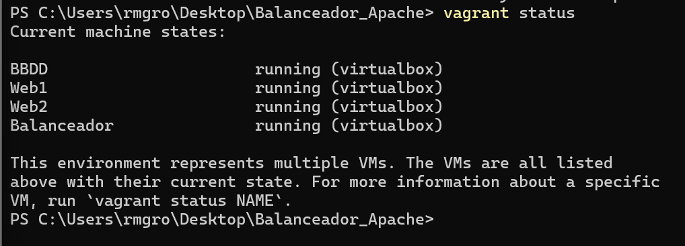

### Identificación de cada servidor

Dentro de cada máquina comprobar el nombre y las interfaces con:

```bash
hostname
ip -br a
```

| Máquina | Hostname esperado | IP privada esperada |
|---|---|---|
| Balanceador | `balanceador-roberto` | `192.168.56.10` |
| Web1 | `web1-roberto` | `192.168.56.11` |
| Web2 | `web2-roberto` | `192.168.56.12` |
| BBDD | `bbdd-roberto` | `192.168.56.13` |

**Identidades:**
- **Balanceador:**
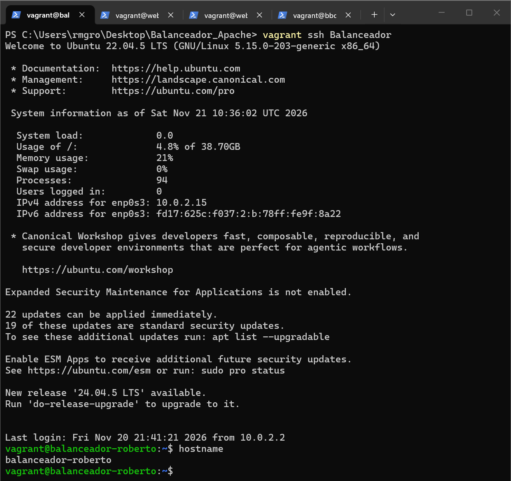

- **Web1:**
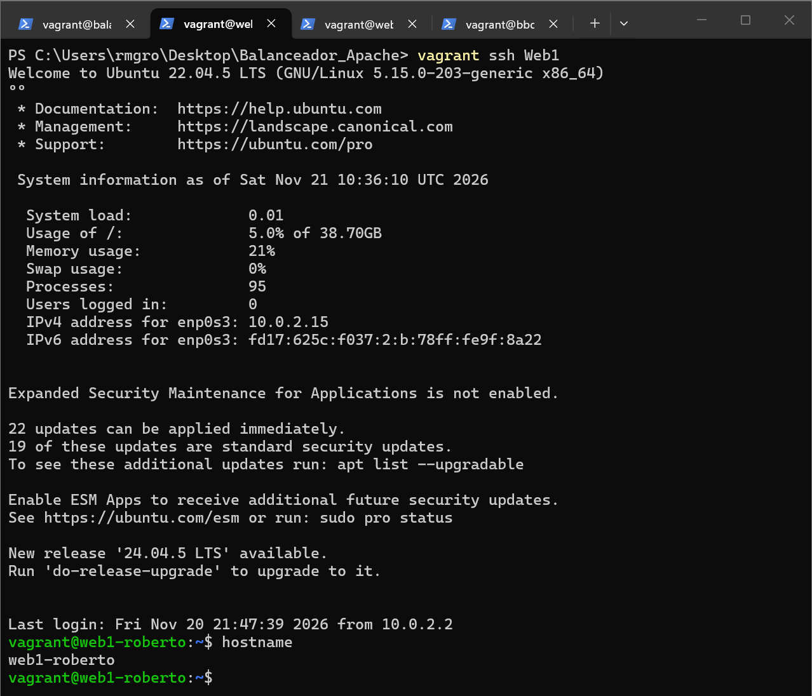

- **Web2:**
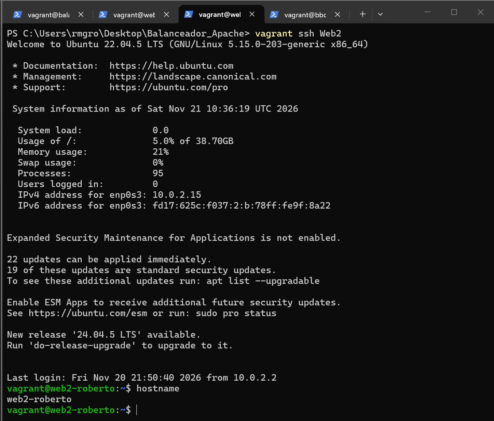

- **BBDD:**
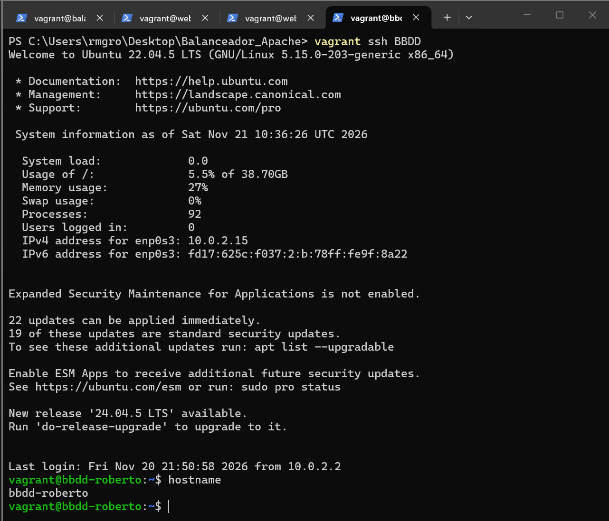


---

## 04 / Comprobación de red y seguridad

### Revisión de interfaces y rutas

En cada máquina comprobar las interfaces y la tabla de rutas:

```bash
ip -br a
ip route
```

Las cuatro máquinas utilizan actualmente una única red privada host-only `192.168.56.0/24`. En esta configuración, las direcciones privadas permiten las comunicaciones entre capas, pero no se han creado tres subredes independientes.

**Capturas de red:**  

**Interfaces y rutas del balanceador**
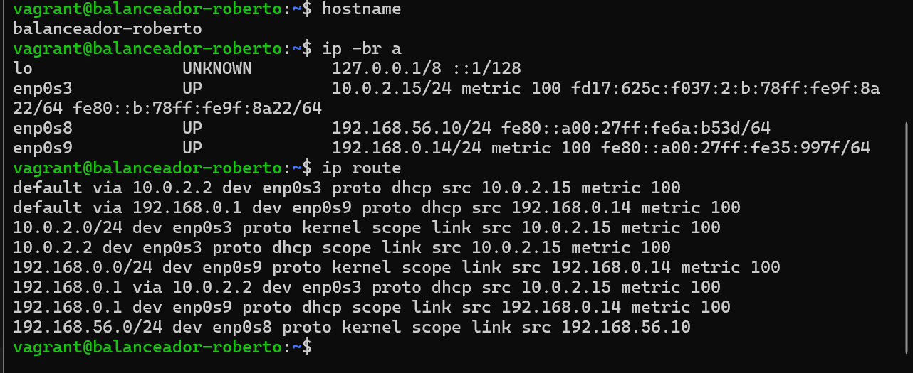

**Interfaces y rutas de Web1**
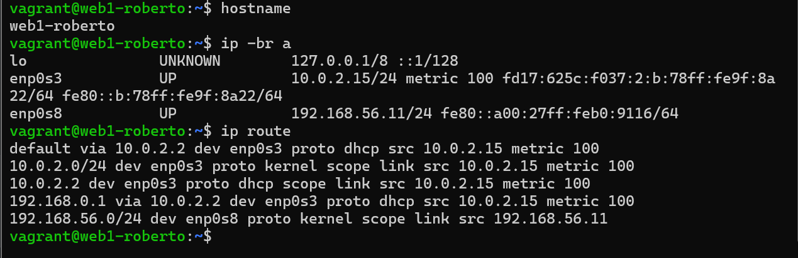

**Interfaces y rutas de Web2**
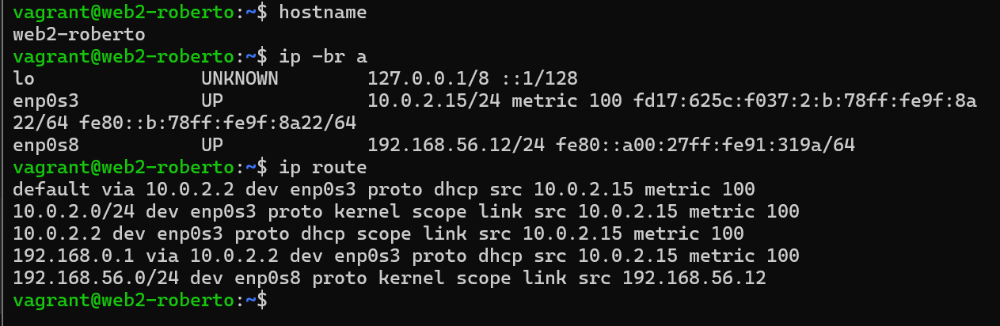

**Interfaces y rutas de BBDD**
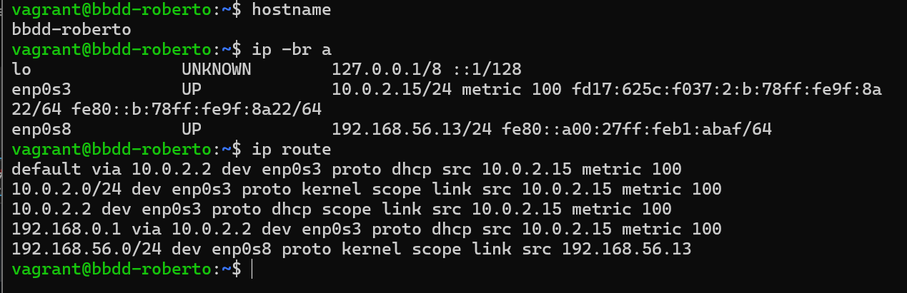

### Verificación de comunicaciones

Desde cada servidor web se debe comprobar la disponibilidad de la base de datos en `192.168.56.13:3306`. Desde el balanceador se comprobará el acceso HTTP a `192.168.56.11:80` y `192.168.56.12:80`.

```bash
curl -I http://192.168.56.11/
curl -I http://192.168.56.12/
```

Desde cada VM, revisar las reglas del cortafuegos:

```bash
sudo ufw status numbered
```

Las reglas UFW configuradas son:

| Máquina | Entradas permitidas | Uso |
|---|---|---|
| Balanceador | TCP 22 desde cualquier origen; TCP 80 y 443 | SSH para administración; HTTP y HTTPS de los clientes |
| Web1 y Web2 | TCP 22 desde cualquier origen; TCP 80 solo desde `192.168.56.10` | SSH para administración; peticiones del balanceador |
| BBDD | TCP 22 desde cualquier origen; TCP 3306 desde `192.168.56.11` y `192.168.56.12` | SSH para administración; consultas MariaDB desde los nodos web |

UFW deniega el tráfico entrante por defecto y permite las conexiones salientes necesarias para instalar paquetes. Los scripts dejan TCP 22 permitido desde cualquier origen accesible a cada VM para facilitar la administración de Vagrant; el router solo reenvía los puertos 80 y 443 al balanceador. Estas reglas son del firewall del sistema operativo; no son NACL ni grupos de seguridad AWS.

**Conectividad del balanceador con Web1 y Web2**
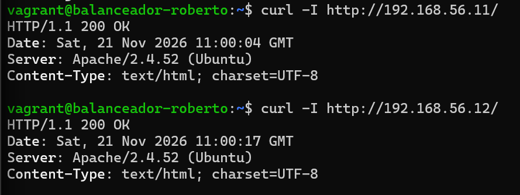

**Conectividad de Web1 y Web2 con MariaDB**
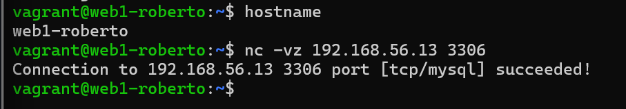

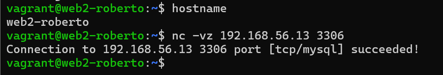

---

## 05 / Configuración del balanceador

### Implementación con Apache

El script `provision/balanceador.sh`, ejecutado automáticamente por Vagrant, instala Apache y activa `proxy`, `proxy_http`, `proxy_balancer` y `lbmethod_byrequests`. Deshabilita HAProxy y configura el balanceo round-robin hacia Web1 (`192.168.56.11`) y Web2 (`192.168.56.12`). No es necesario ejecutar `a2enmod` manualmente en una instalación limpia.

La activación de módulos es:

```bash
sudo a2enmod proxy proxy_http proxy_balancer lbmethod_byrequests
```

El aprovisionador crea este VirtualHost. La excepción y el alias ACME permiten que Certbot valide el dominio sin enviar el desafío a los backends:

```apache
<VirtualHost *:80>
    ServerName rmunnozg15.ddns.net
    ProxyPreserveHost On

    ProxyPass "/.well-known/acme-challenge/" "!"
    Alias "/.well-known/acme-challenge/" "/var/lib/letsencrypt/.well-known/acme-challenge/"
    <Directory "/var/lib/letsencrypt/.well-known/acme-challenge/">
        Options None
        AllowOverride None
        Require all granted
    </Directory>

    <Proxy "balancer://webcluster">
        BalancerMember "http://192.168.56.11:80"
        BalancerMember "http://192.168.56.12:80"
        ProxySet lbmethod=byrequests
    </Proxy>

    ProxyPass        "/" "balancer://webcluster/"
    ProxyPassReverse "/" "balancer://webcluster/"
</VirtualHost>
```

La configuración del virtual host se guarda en `/etc/apache2/sites-available/load-balancer.conf`. Se valida con `apachectl configtest`; el servicio debe estar activo y escuchar en `*:80`.

Para comprobarlo en la VM:

```bash
sudo systemctl is-active apache2
sudo apachectl -S
sudo apachectl configtest
```

Desde Windows se accede localmente a `http://127.0.0.1:8080`. Para acceder desde Internet también se necesita el reenvío TCP 80 del router a la IP puente de la VM, explicado en el apartado HTTPS.

**Apache activo en el balanceador** 
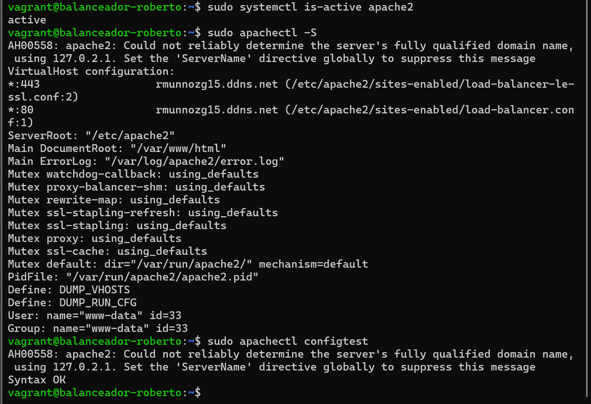

**Backends Web1 y Web2 configurados en Apache**
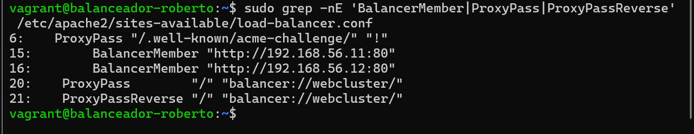

---

## 06 / Preparación de los servidores web

### Instalación y configuración

El script `provision/web.sh` instala Apache, PHP, el módulo PHP para MariaDB y el cliente de base de datos. Despliega una página que muestra el nombre e IP del nodo y consulta `estado`. Usa `${NAME}` y `${IP}` para rellenar la identidad del backend y elimina el `index.html` predeterminado de Apache para que se sirva el archivo PHP.

En cada nodo web comprobar:

```bash
sudo systemctl is-active apache2
sudo systemctl status apache2
```

Desde el balanceador, comprobar que ambos destinos contestan por HTTP. El navegador debe mostrar el backend que responde y el resultado de la consulta a MariaDB.

**Evidencias de los servidores web:**  
Capturas de los servidores web en `pruebas/04-servicios/`:

**Apache activo en Web1**
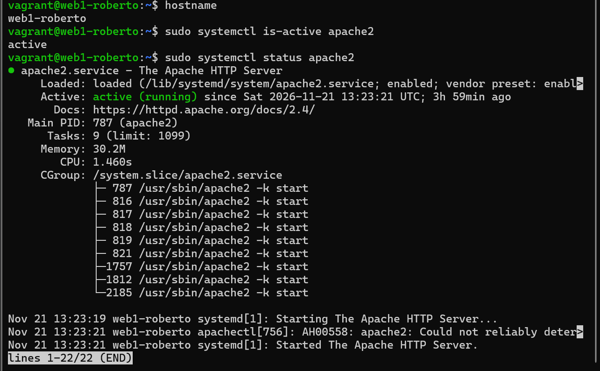

**Apache activo en Web2**
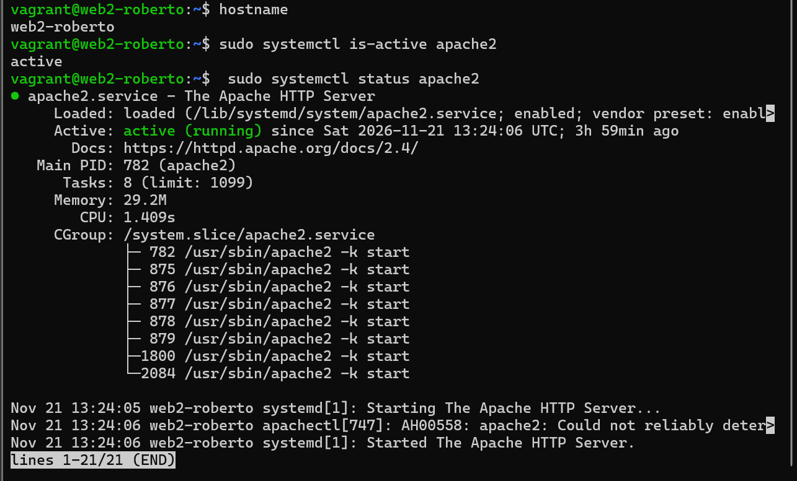

---

## 07 / Preparación de la base de datos

### Instalación y configuración

El script `provision/bbdd.sh` instala MariaDB y configura la escucha en `192.168.56.13`. Después de cambiar `bind-address`, reinicia el servicio para aplicar la nueva dirección. Crea la base `demo`, la tabla `estado` y un usuario de aplicación con permisos de lectura. UFW permite TCP 3306 únicamente desde Web1 y Web2.

En la máquina BBDD comprobar el servicio:

```bash
sudo systemctl is-active mariadb
sudo systemctl status mariadb
```

Y verificar la base y la tabla mediante el cliente MariaDB:

```sql
SHOW DATABASES;
USE demo;
SHOW TABLES;
SELECT * FROM estado;
```

> Los scripts de aprovisionamiento contienen actualmente una contraseña de demostración. Antes de publicar el repositorio, sustitúyela por una variable local excluida del control de versiones. No uses una contraseña personal ni publiques secretos.


**MariaDB activo**
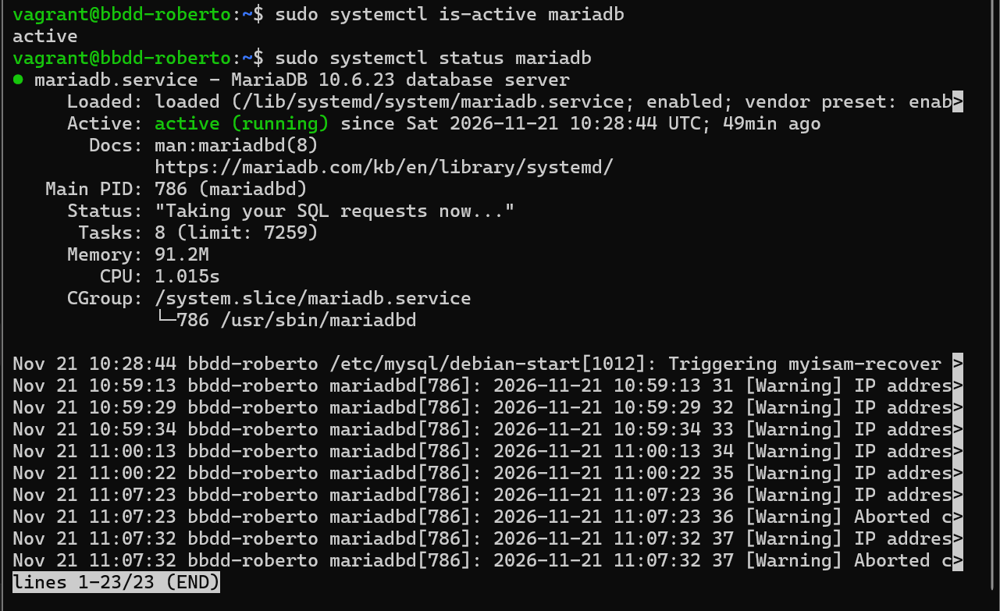


**Base, tabla y consulta de prueba**
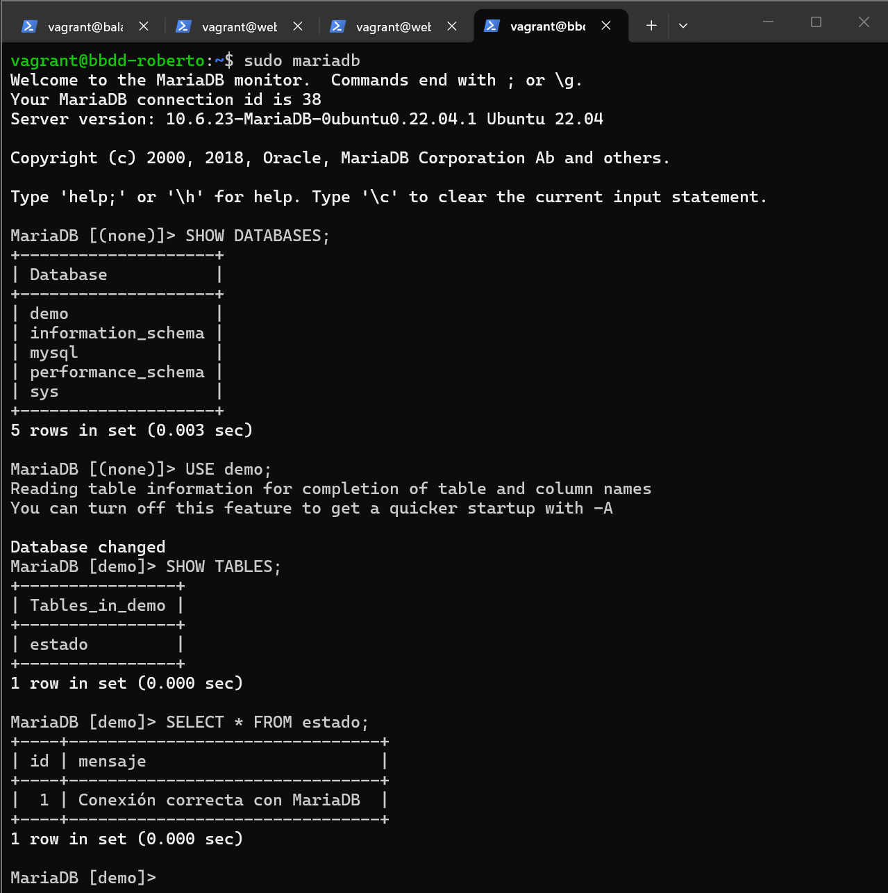

---

## 08 / Dominio y certificados HTTPS

### Certificado autofirmado para pruebas locales

Un certificado autofirmado permite practicar la configuración TLS, pero el navegador mostrará una advertencia porque no lo firma una autoridad de confianza. No se debe presentar como certificado público válido.

La guía de prácticas propone crear la clave y el certificado con OpenSSL y configurar un VirtualHost Apache en el puerto 443. Para usarlo en este laboratorio, el frontal debe ejecutar Apache, habilitar los módulos `ssl` y `rewrite`, aceptar TCP 443 en UFW y reenviar el puerto 443 invitado a un puerto local, por ejemplo 8443. La resolución de `balanceador.test` puede añadirse al archivo hosts de Windows con `127.0.0.1 balanceador.test`.

### Certificado público con Certbot y Let’s Encrypt

Para emitir un certificado público, el nombre DNS debe resolver hacia una dirección pública y la validación HTTP-01 debe poder alcanzar el frontal por TCP 80. El reenvío Vagrant del puerto invitado 80 a `127.0.0.1:8080` sirve para acceder desde el equipo anfitrión, pero no expone por sí solo el servicio a Internet. En esta práctica se habilitó el acceso público mediante la interfaz puente Wi-Fi y las reglas de reenvío del router descritas a continuación.

El aprovisionador instala Certbot y solicita el certificado automáticamente cuando el dominio y el reenvío público del puerto 80 permiten completar HTTP-01. Si la validación no está disponible durante `vagrant up`, la página HTTP se mantiene operativa y, una vez corregida la conectividad, el certificado se puede solicitar en el balanceador con:

```bash
sudo snap install --classic certbot
sudo ln -s /snap/bin/certbot /usr/local/bin/certbot
sudo certbot --apache -d rmunnozg15.ddns.net
sudo certbot certificates
sudo certbot renew --dry-run
sudo systemctl list-timers
```

#### Resultado: certificado público instalado

La primera solicitud de Certbot falló porque se intentó incluir `www.rmunnozg15.ddns.net`, que no tiene un registro DNS (`NXDOMAIN`), y porque la validación HTTP-01 no completaba la conexión. Se corrigió la configuración de red y se solicitó el certificado únicamente para el nombre DNS que existe: `rmunnozg15.ddns.net`.

El balanceador tiene tres interfaces: NAT (`enp0s3`, `10.0.2.15`), host-only (`enp0s8`, `192.168.56.10`) y puente Wi-Fi (`enp0s9`, `192.168.0.14`). Se detectaron dos rutas por defecto. La IP puente se fijó en el `Vagrantfile` como `192.168.0.14`, el destino de los reenvíos del router. Para que las respuestas a conexiones públicas regresen por el router de la red Wi-Fi, se configuró una ruta estática con métrica 50 en `enp0s9`. El ajuste persistente se guarda en `/etc/netplan/99-balanceador-route.yaml` y se aplica también desde `provision/balanceador.sh`.

Para dar acceso público al balanceador, se entró en la configuración del router doméstico Sercomm y se añadieron dos reglas de redirección de puertos hacia la IP puente fija `192.168.0.14`:

| Servicio | Protocolo | Puerto público | IP de destino en la LAN | Puerto de destino |
|---|---|---:|---|---:|
| HTTP | TCP | 80 | `192.168.0.14` | 80 |
| HTTPS | TCP | 443 | `192.168.0.14` | 443 |

Así, las conexiones que llegan al router por TCP 80 o 443 se envían al mismo puerto del balanceador. No se reenvía el puerto SSH. Esta configuración del router es distinta del reenvío de Vagrant `guest: 80` a `127.0.0.1:8080`, que solo permite acceder desde el PC anfitrión. En la VM, UFW permite TCP 22 para administración y TCP 80/443 para HTTP y HTTPS. Apache atiende el desafío `/.well-known/acme-challenge/` y distribuye el resto de las peticiones a Web1 y Web2.

La emisión se completó correctamente con:

```bash
sudo certbot --apache -d rmunnozg15.ddns.net
```

Certbot validó el dominio mediante HTTP-01, instaló el certificado en Apache y dejó configurada su renovación automática. La inspección de `sudo certbot certificates` mostró el certificado `rmunnozg15.ddns.net`, con vencimiento el **19/02/2027**. Una petición HTTPS local con validación normal del certificado devolvió `HTTP 200 OK`, y el dominio se comprobó desde el móvil usando datos móviles.

En Windows, el acceso HTTP desde el PC se puede hacer mediante `http://127.0.0.1:8080` o `http://192.168.0.14`. Para usar el mismo dominio por HTTPS desde la red local, el router no debe interceptar la conexión dirigida a su propia IP pública. En este router, añade una resolución local en el archivo `C:\Windows\System32\drivers\etc\hosts` desde PowerShell **como administrador**:

```powershell
Add-Content -LiteralPath "$env:SystemRoot\System32\drivers\etc\hosts" -Value "`r`n192.168.0.14 rmunnozg15.ddns.net"
ipconfig /flushdns
```

Esta entrada solo afecta al PC configurado. Fuera de la red local, elimina esa línea para que el nombre vuelva a resolverse mediante el DNS público.

Si Certbot indica que ya existe un certificado vigente y ofrece reinstalarlo o renovarlo, se debe elegir **1: Attempt to reinstall this existing certificate** para reinstalar el certificado existente. No se necesita solicitar otro certificado ni elegir la opción 2 mientras siga vigente.

Comprobaciones útiles:

```bash
sudo certbot certificates
sudo certbot renew --dry-run
sudo systemctl list-timers
```

**Renovación de prueba del certificado con Certbot** 
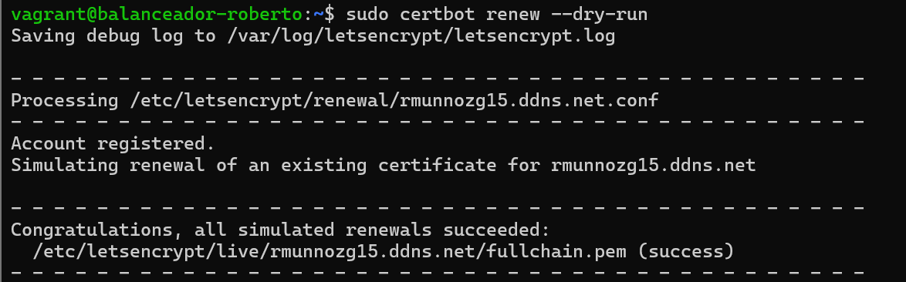

**Acceso local por HTTP a la IP puente del balanceador**
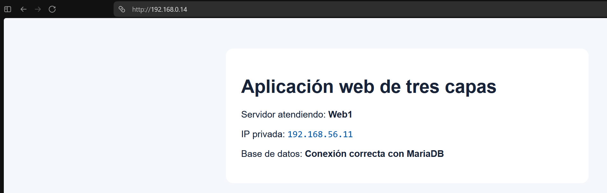

**Dominio cargado por HTTPS**
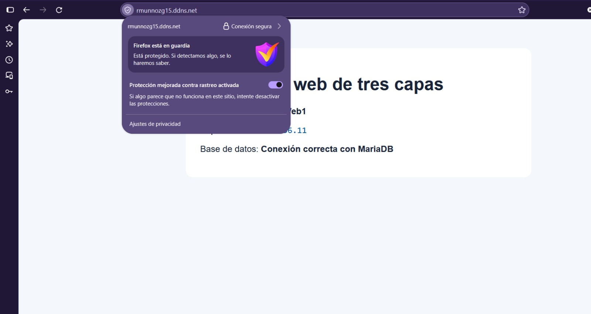

---
## 09 / Pruebas de funcionamiento

### Comprobaciones de los servicios

Resultados observados durante la comprobación del despliegue:

| Prueba | Comando o acción | Resultado esperado | Resultado real |
|---|---|---|---|
| Estado de VM | `vagrant status` | Cuatro máquinas `running` | Confirmado: BBDD, Web1, Web2 y Balanceador en ejecución |
| Apache Web1 | `systemctl is-active apache2` | `active` | `active` |
| Apache Web2 | `systemctl is-active apache2` | `active` | `active` |
| MariaDB | `systemctl is-active mariadb` | `active` | `active` |
| Apache balanceador | `systemctl is-active apache2` | `active` | `active` |
| HAProxy | `systemctl is-active haproxy` | `disabled` | `disabled` |
| Acceso web | Seis peticiones a `http://127.0.0.1:8080` | Página de demostración | Seis respuestas HTTP 200 |
| Balanceo | Repetir peticiones desde el navegador | Responden Web1 y Web2 | Alternaron Web1/Web2 tres veces cada uno |
| Consulta BBDD | Ver mensaje de estado en la página | Conexión MariaDB correcta | `Conexión correcta con MariaDB` en ambos backends |
| Filtrado | Revisar `ufw status numbered` | Solo puertos/orígenes necesarios | Reglas aplicadas por los scripts; falta adjuntar captura de comprobación |

### Evidencias de la aplicación

Esta captura añadida a continuación muestra una petición desde el balanceador a Web2 y su respuesta `HTTP/1.1 200 OK`:

**Comunicación del balanceador con Web2 (HTTP 200)**
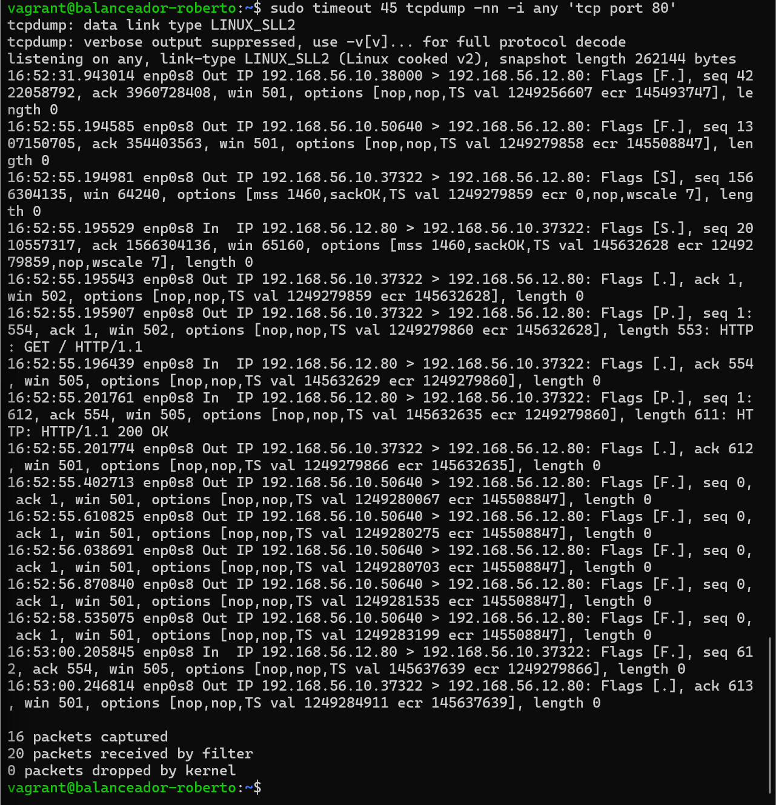

**Aplicación servida por Web1**
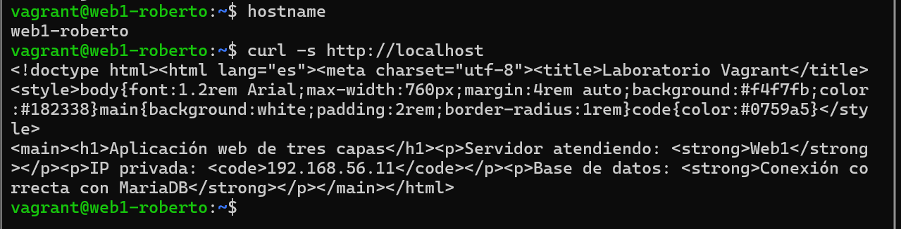

**Aplicación servida por Web2**
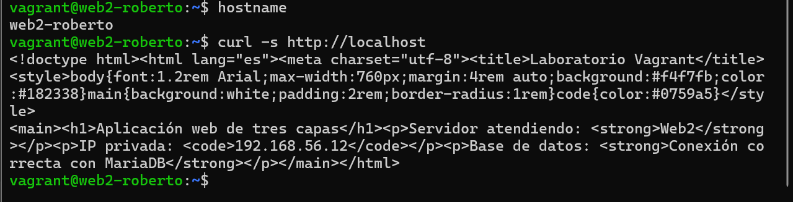

**Conexión correcta con MariaDB**
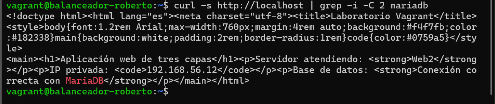

**Peticiones sucesivas que muestran el balanceo**
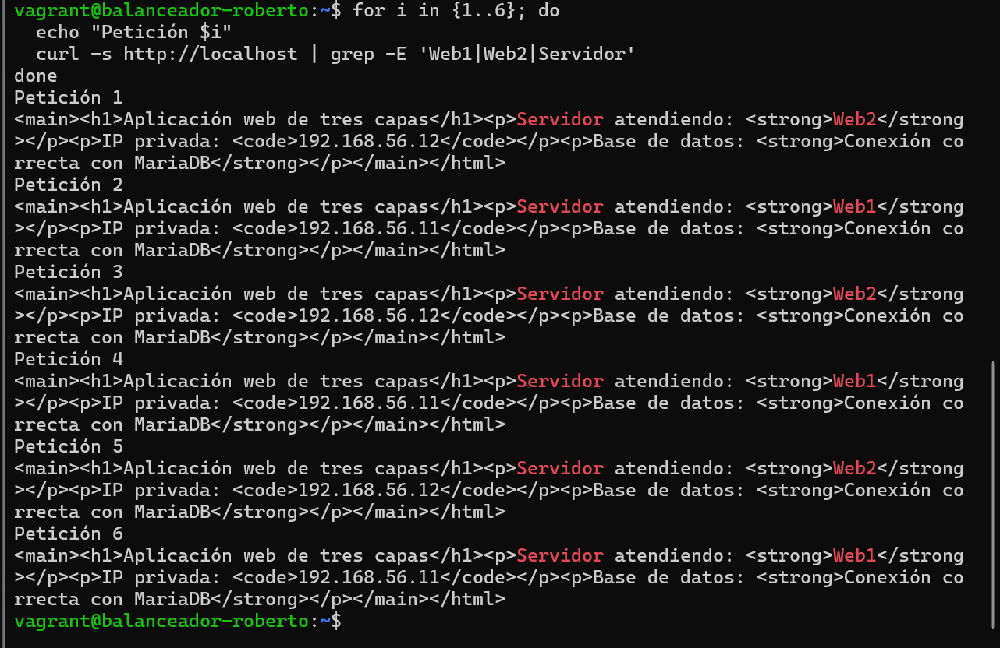

---

## 10 / Vídeo demostración

[\[URL del vídeo\]](https://www.youtube.com/watch?v=RsxlzajpWgY)


---

## Incidencias y limitaciones

- `vagrant provision` se ejecutó correctamente en las cuatro máquinas. Se corrigió `provision/bbdd.sh` para reiniciar MariaDB después de cambiar `bind-address`.
- La primera prueba HTTP mostró la página de bienvenida de Apache. Se corrigió `provision/web.sh` para quitar `index.html` y usar las variables `${NAME}` y `${IP}` en la página de prueba.
- Tras volver a aprovisionar Web1 y Web2, seis solicitudes respondieron con HTTP 200, alternaron entre los nodos y confirmaron la conexión con MariaDB.
- El frontal se aprovisiona ahora con Apache como proxy inverso y balanceador round-robin. `provision/balanceador.sh` deshabilita HAProxy, activa los módulos requeridos, mantiene libre de proxy la ruta ACME y configura UFW para 22, 80 y 443.
- El escenario local usa una única red host-only y UFW. No equivale a una VPC con tres subredes, Elastic IP, NACL ni grupos de seguridad AWS.
- El certificado público de Certbot ya está emitido y funciona para `rmunnozg15.ddns.net`. El nombre `www.rmunnozg15.ddns.net` sigue sin registro DNS y no debe añadirse a Certbot hasta crearlo. El certificado autofirmado queda como alternativa didáctica local y no es necesario para demostrar el HTTPS público.
- Si reaparece `E_ACCESSDENIED`, cerrar VirtualBox y probar la consola de PowerShell como administrador. Confirmar el resultado con `vagrant status`.

---

## Recursos utilizados

- Guía de Vagrant proporcionada para la práctica.
- `ApacheBalanceador.pdf`.
- `CertificadoAutofirmado.pdf`.
- `HTTPS con Let’s Encrypt y Certbot.pdf`.
- https://www.noip.com/es-MX
- [Documentación de Vagrant: máquinas múltiples](https://developer.hashicorp.com/vagrant/docs/multi-machine).
- [Documentación de Apache: mod_proxy_balancer](https://httpd.apache.org/docs/2.4/mod/mod_proxy_balancer.html).
- [Instrucciones de Certbot para Apache](https://certbot.eff.org/instructions?os=snap&ws=apache).
- [Desafíos de Let’s Encrypt](https://letsencrypt.org/docs/challenge-types/).
- [Límites de archivos de GitHub](https://docs.github.com/en/repositories/creating-and-managing-repositories/repository-limits).

---

## Datos del trabajo

- **Realizado por:** Roberto Muñoz Galán  
- **Ciclo formativo:** ASIR 2
- **Módulo:** Implantación de Aplicaciones Web
- **Fecha de realización:** 18/11/2026
