# Laboratorio de servidores virtuales
### Montaje y comprobación de un entorno web con base de datos independiente

**Documentación de trabajo — Roberto Muñoz Galán**

---

## Vista general del laboratorio

El objetivo de este montaje es conseguir que una aplicación web funcione utilizando dos equipos virtuales diferentes. Uno atenderá las peticiones del navegador y el otro guardará la información de la aplicación.

Para realizarlo utilizaré Vagrant sobre VirtualBox, con Debian 12 como sistema operativo de los servidores.

El trabajo se dividirá en cuatro fases:

| Fase | Trabajo que realizaré |
|:---:|---|
| 01 | Preparar las máquinas y sus conexiones |
| 02 | Instalar y configurar los servicios |
| 03 | Incorporar la aplicación web |
| 04 | Comprobar el funcionamiento y documentar los resultados |

La condición principal de la infraestructura es mantener separado el servicio de base de datos del acceso exterior. El servidor web podrá conectarse a Internet, pero el equipo que almacene los datos deberá funcionar sin acceso a Internet.

---

## 01 / Preparación del escenario

### Equipos que forman parte del montaje

Para este ejercicio trabajaré con un ordenador Windows como anfitrión y dos servidores virtuales Debian.

He elegido los siguientes nombres para identificar cada máquina:

- `rmg-site`: servidor encargado de Apache y la aplicación.
- `rmg-data`: equipo que alojará MariaDB.

Las direcciones previstas para la red privada serán:

```text
rmg-site    192.168.56.10
rmg-data    192.168.56.20
```

Ambos servidores tendrán la máscara `255.255.255.0`.

### Representación del funcionamiento

El laboratorio está compuesto por un ordenador Windows y dos máquinas virtuales Debian 12.

**1. Ordenador anfitrión (Windows)**
- Ejecuta VirtualBox y Vagrant.
- Permite acceder a la aplicación desde el navegador mediante `http://127.0.0.1:8080`.

**2. Servidor web (`rmg-site`)**
- Sistema operativo: Debian 12.
- Servicios: Apache y PHP.
- Dirección IP privada: `192.168.56.10`.
- Dispone de conexión a Internet mediante NAT.
- Recibe las peticiones web a través del puerto 80.

**3. Servidor de base de datos (`rmg-data`)**
- Sistema operativo: Debian 12.
- Servicio: MariaDB.
- Dirección IP privada: `192.168.56.20`.
- No permite nuevas conexiones de salida hacia Internet una vez finalizado el aprovisionamiento.
- Acepta conexiones del servidor web mediante el puerto 3306.

**Comunicación entre los equipos:**

```text
Windows (127.0.0.1:8080)
          |
          | Reenvío de puertos
          v
Servidor web (192.168.56.10)
Apache + PHP
          |
          | Red privada (puerto 3306)
          v
Servidor de datos (192.168.56.20)
MariaDB
```

De esta forma, el navegador se comunica con Apache y este último accede a MariaDB cuando necesita consultar o modificar información. El servidor de base de datos no se publica directamente al ordenador anfitrión.

Cuando acceda a la aplicación desde Windows, la petición llegará al servidor web. Si necesita consultar algún usuario o guardar información, Apache se comunicará con el servidor de base de datos mediante la red privada.

De esta forma, el navegador no tendrá que acceder directamente a MariaDB.

### Herramientas del equipo anfitrión

Antes de crear las máquinas comprobaré las herramientas instaladas en Windows.

En PowerShell ejecutaré:

```powershell
vagrant --version
```

```powershell
VBoxManage.exe --version
```

**Versiones instaladas:**

```text
Vagrant:    Vagrant 2.4.9
VirtualBox: 7.2.20r175154
```

**Evidencia del equipo:**

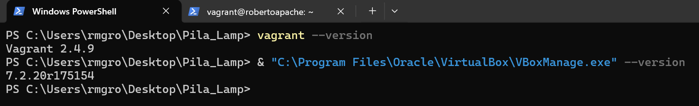

---

## 02 / Archivos del laboratorio

Antes de comenzar el despliegue, organizaré los archivos que utilizaré durante la actividad.

La carpeta principal estará dividida en la configuración de Vagrant, los scripts de instalación, los archivos de la aplicación y las pruebas.

```text
Pila_Lamp/
│
├── Vagrantfile
├── README.md
│
├── bootstrap/
│   ├── web-setup.sh
│   └── database-setup.sh
│
├── pruebas/
│   ├── 01-inicio/
│   ├── 02-maquinas/
│   ├── 03-red/
│   ├── 04-instalacion/
│   └── 05-web/
│
├── grabacion/
│   └── recorrido.mp4
│
└── aplicacion/
    ├── db/
    │   └── database.sql
    └── src/
        ├── add.html
        ├── add.php
        ├── config.php
        ├── delete.php
        ├── edit.php
        └── index.php
```

La carpeta `bootstrap` guardará los scripts Bash.

En `pruebas` colocaré las capturas de pantalla, separadas según la parte del ejercicio que esté realizando.

El archivo `README.md` será el documento que explique el montaje y los resultados.

---

## 03 / Construcción de las máquinas

### Configuración utilizada

Vagrant permite describir las máquinas en un archivo y crearlas desde Windows sin tener que configurar todo manualmente en VirtualBox.

Utilizaré Debian 12 como sistema base:

```ruby
config.vm.box = "debian/bookworm64"
```

En el `Vagrantfile` definiré los dos servidores, sus nombres, las conexiones de red y los scripts que deberán ejecutarse.

**Configuración completa:**

```ruby
# -*- mode: ruby -*-
# vi: set ft=ruby :

Vagrant.configure("2") do |config|
  # Imagen base Debian 12 para las dos máquinas.
  config.vm.box = "debian/bookworm64"

  # Servidor web: Apache + PHP + aplicación.
  config.vm.define "rmg-site" do |web|
    web.vm.hostname = "robertoapache"
    web.vm.network "private_network", ip: "192.168.56.10"
    web.vm.network "forwarded_port", guest: 80, host: 8080, host_ip: "127.0.0.1"

    # Los archivos PHP de la aplicación estarán en esta carpeta de Windows.
    web.vm.synced_folder "./aplicacion/src", "/var/www/html",
      owner: "www-data", group: "www-data", mount_options: ["dmode=775", "fmode=664"]

    web.vm.provision "shell", path: "bootstrap/web-setup.sh"
  end

  # Servidor de base de datos: no se publica ningún puerto hacia Windows.
  # El script instala MariaDB, configura el acceso privado y bloquea la salida a Internet.
  config.vm.define "rmg-data" do |db|
    db.vm.hostname = "robertosql"
    db.vm.network "private_network", ip: "192.168.56.20"

    db.vm.provision "shell",
      path: "bootstrap/database-setup.sh",
      env: {
        "DB_NAME" => "lamp_db",
        "DB_USER" => "lamp_roberto",
        "DB_PASS" => "8888"
      }
  end
end
```

Definición de las máquinas: Se crean dos máquinas virtuales utilizando config.vm.define. La primera se llama rmg-site y está destinada al servidor web, mientras que la segunda se llama rmg-data y se utiliza como servidor de base de datos. Ambas utilizan Debian 12 como sistema operativo.

Configuración de red: Cada máquina tiene una dirección IP privada fija dentro de la red de VirtualBox. El servidor web utiliza 192.168.56.10 y el servidor de base de datos 192.168.56.20. Esto permite que ambos servidores se comuniquen entre sí sin necesidad de utilizar la red pública.

Reenvío de puertos: En el servidor web se configura forwarded_port para conectar el puerto 80 de la máquina virtual con el puerto 8080 de Windows. De esta forma, puedo acceder a Apache desde el navegador del equipo anfitrión mediante http://127.0.0.1:8080. El servidor de base de datos no tiene ningún puerto reenviado hacia Windows.

Vinculación de los scripts Bash: Cada máquina tiene asociado un script de aprovisionamiento mediante vm.provision "shell". El servidor web ejecuta bootstrap/web-setup.sh, mientras que el servidor de datos ejecuta bootstrap/database-setup.sh. En este último también se envían variables de entorno con el nombre de la base de datos, el usuario y la contraseña.

Además, el servidor web tiene configurada una carpeta compartida mediante synced_folder. Esto permite que los archivos de ./aplicacion/src de Windows estén disponibles directamente en /var/www/html dentro de Debian, que es el directorio donde Apache sirve la aplicación.

### Puesta en marcha

Con los archivos preparados, abriré PowerShell desde la carpeta del proyecto.

Primero revisaré la sintaxis del archivo:

```powershell
vagrant validate
```

Después iniciaré la infraestructura:

```powershell
vagrant up
```

Y comprobaré qué máquinas están funcionando:

```powershell
vagrant status
```

**Registro del primer arranque:**

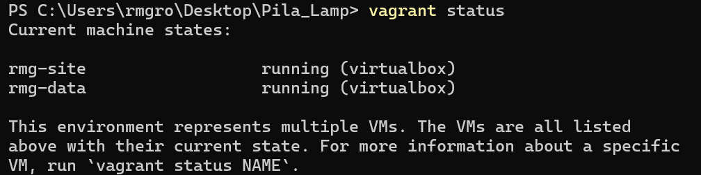

### Identificación de cada servidor

Una vez creados, entraré en los servidores y consultaré sus nombres.

```bash
hostname
```

| Equipo comprobado | Nombre que muestra Debian |
|---|---|
| Servidor web | robertoapache |
| Servidor de datos | robertosql |

**Nombres de las máquinas desde ssh:**

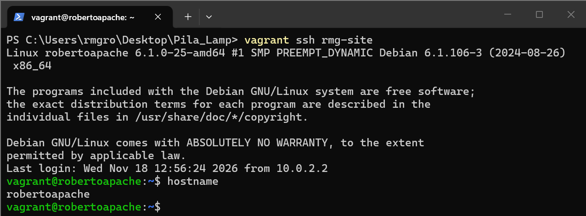

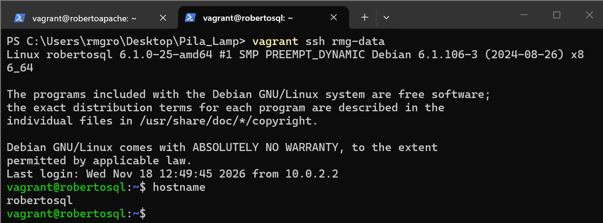

Los nombres obtenidos con el comando hostname coinciden con los definidos en el Vagrantfile. El servidor web utiliza el nombre robertoapache y el servidor de base de datos robertosql.

Esto confirma que la configuración de los nombres de host se ha aplicado correctamente en ambas máquinas y permite distinguir fácilmente cada servidor al trabajar desde la terminal.

---

## 04 / Comprobación de las conexiones

En esta fase revisaré las interfaces, las rutas y la comunicación entre las máquinas.

El objetivo es comprobar que cada servidor tenga solamente la conectividad que necesita.

### Revisión de interfaces

Dentro de cada máquina utilizaré:

```bash
ip a
```

Este comando mostrará las interfaces de red y las direcciones IP asignadas.

**Servidor rmg-site:**

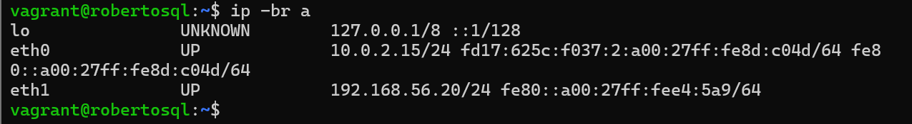

**Servidor rmg-data:**

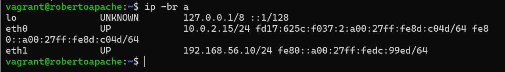

| Comprobación | rmg-site | rmg-data |
|---|---|---|
| IP de la red privada | 192.168.56.10/24 | 192.168.56.20/24 |
| Interfaz NAT | 10.0.2.15/24 | 10.0.2.15/24 |
| Otras interfaces | 127.0.0.1/8 | 127.0.0.1/8 |

### Tabla de rutas

Para comprobar por dónde puede enviar tráfico cada servidor ejecutaré:

```bash
ip route
```

Es importante revisar la ruta predeterminada.

Apache debe tener una vía de acceso a Internet. En cambio, MariaDB no deberá disponer de una ruta que permita salir a Internet.

**Rutas de rmg-site:**

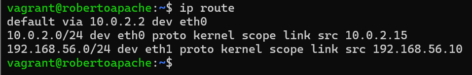

**Rutas de rmg-data:**

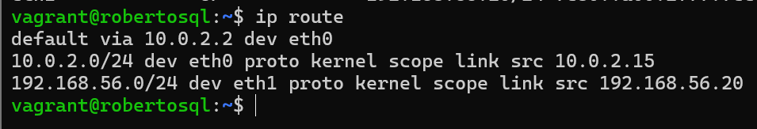

**Interpretación de los resultados:**

En el servidor web, la tabla de rutas incluye la red privada 192.168.56.0/24 y una ruta predeterminada a través de la interfaz NAT. Esta última permite enviar tráfico hacia direcciones que no pertenecen a las redes locales, como las direcciones de Internet.

En el servidor de datos también pueden aparecer las rutas de la red privada y de la interfaz NAT. Sin embargo, esto no significa que tenga permitido acceder a Internet, ya que las reglas de nftables bloquean las nuevas conexiones de salida.

Por tanto, las rutas indican por dónde se puede intentar enviar el tráfico, mientras que el cortafuegos determina qué comunicaciones están permitidas.

### Verificación de la comunicación privada

Desde el servidor web comprobaré si responde la segunda máquina:

```bash
ping -c 4 192.168.56.20
```

Después realizaré la prueba contraria desde el servidor de datos:

```bash
ping -c 4 192.168.56.10
```

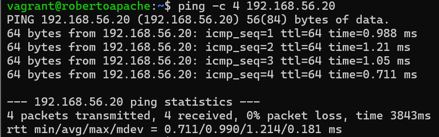

Las pruebas permiten comprobar que existe comunicación entre los dos servidores a través de la red privada. El servidor web puede comunicarse con el servidor de datos y viceversa.

Esta comunicación es necesaria para que Apache y PHP puedan acceder a MariaDB mediante la dirección privada 192.168.56.20, utilizando el puerto 3306.

### Prueba de acceso exterior

Para comprobar el acceso a Internet utilizaré la siguiente dirección:

```bash
ping -c 4 1.1.1.1
```

Realizaré la prueba desde los dos servidores.

| Origen de la prueba | Comportamiento esperado | Resultado real |
|---|---|---|
| rmg-site | Puede comunicarse con el exterior | Se comunica con el exterior sin problema |
| rmg-data | No debe disponer de acceso exterior | No tiene conexión con el exterior |

**Prueba realizada desde Apache:**

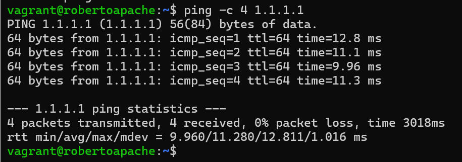

**Prueba realizada desde la base de datos:**

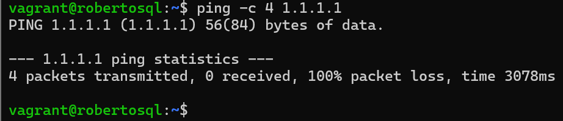

El aislamiento del servidor de datos se realiza mediante nftables, que funciona como cortafuegos y controla las conexiones de red.

En el script bootstrap/database-setup.sh se configura el archivo /etc/nftables.conf con las siguientes restricciones:

  Se bloquean por defecto las conexiones nuevas de salida mediante la política drop de la cadena output.

  Se permiten las comunicaciones por la interfaz local.

  Se permiten las conexiones que ya estaban establecidas y las relacionadas con ellas.

  Se permite el tráfico necesario para DHCP.

  Se permite la comunicación con la red privada 192.168.56.0/24.

  Se permite el acceso a MariaDB desde el servidor web mediante el puerto 3306.

De esta forma, rmg-data puede comunicarse con rmg-site para proporcionar el servicio de base de datos, pero no puede iniciar nuevas conexiones hacia Internet.

Por tanto, el aislamiento no depende únicamente de que falle el comando ping, sino de las reglas del cortafuegos que controlan el tráfico de salida.

---

## 05 / Preparación de Apache

El primer servicio que configuraré será Apache, encargado de atender las peticiones HTTP de la aplicación.

Para preparar el servidor utilizaré el script:

```text
bootstrap/web-setup.sh
```

Este archivo se ejecutará durante el aprovisionamiento de la máquina virtual.

### Script de instalación

```bash
#!/bin/bash
set -e

# Instala Apache, PHP y el módulo de conexión con MariaDB.
export DEBIAN_FRONTEND=noninteractive
apt-get update
apt-get install -y apache2 php libapache2-mod-php php-mysql

# Activa Apache y lo inicia.
systemctl enable --now apache2

# Comprueba que Apache está activo.
systemctl is-active --quiet apache2

```

### Funcionamiento del script

El script instala los siguientes paquetes:

  apache2: instala el servidor web Apache, encargado de recibir y responder a las peticiones HTTP.

  php: instala el intérprete de PHP, necesario para ejecutar los archivos de la aplicación.

  libapache2-mod-php: permite que Apache pueda procesar directamente los archivos PHP.

  php-mysql: proporciona a PHP los controladores necesarios para conectarse a bases de datos MySQL y MariaDB.

Antes de instalar los paquetes se ejecuta apt-get update, que actualiza la información de los repositorios para que el sistema pueda localizar las versiones disponibles.

También se utiliza DEBIAN_FRONTEND=noninteractive para evitar que la instalación solicite respuestas manuales durante el aprovisionamiento.

**Configuraciones que modifica:**

El script no modifica manualmente los archivos de configuración de Apache. La instalación de los paquetes prepara los componentes necesarios para ejecutar el servidor web y procesar PHP.

Preparación de los archivos de la aplicación:

Los archivos de la aplicación se encuentran en la carpeta ./aplicacion/src del proyecto en Windows.

Mediante la configuración synced_folder del Vagrantfile, esta carpeta se comparte con la máquina virtual y aparece en:

```bash
/var/www/html
```

Este es el directorio que utiliza Apache para servir los archivos de la página web.

Además, se configura el propietario y el grupo como www-data, que es el usuario utilizado por Apache en Debian.

**Activación del servicio:**

Para terminar, el script ejecuta:

systemctl enable --now apache2

Este comando configura Apache para que se inicie automáticamente al arrancar Debian y también lo inicia en ese momento.

**Después se ejecuta:**

systemctl is-active --quiet apache2

Con esta instrucción se comprueba que el servicio está activo. Si no lo está, el comando devuelve un código de error.

### Ejecución del script

El script se ejecuta automáticamente cuando Vagrant crea la máquina o realiza su aprovisionamiento.

También puedo volver a ejecutarlo manualmente desde PowerShell mediante:

```powershell
vagrant provision rmg-site
```


La conexión llega al puerto 80 de Apache mediante el reenvío de puertos configurado en Vagrant.

La conexión llega al puerto 80 de Apache mediante el reenvío de puertos configurado en Vagrant.

### Comprobación de Apache

Para verificar el estado del servicio ejecutaré:

```bash
systemctl status apache2
```

Este comando muestra información sobre el servicio Apache, indicando si está activo, detenido o si ha producido algún error.

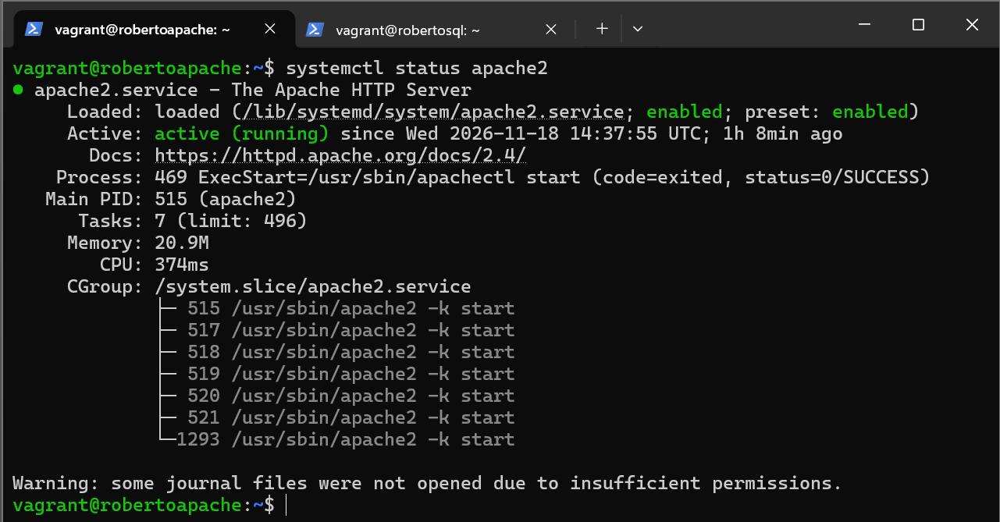

Si el resultado muestra active (running), significa que Apache está iniciado y funcionando correctamente.

También puedo comprobar que responde a las peticiones HTTP desde el navegador de Windows utilizando la dirección http://127.0.0.1:8080.

Con estas comprobaciones verifico que Apache se ha instalado, se ha iniciado correctamente y está preparado para servir los archivos de la aplicación.

---

## 06 / Preparación del almacenamiento de datos

El segundo servidor tendrá la función de almacenar la información que utilice la aplicación web.

Para ello instalaré MariaDB, dependiendo de los requisitos de la aplicación proporcionada.

La configuración se realizará mediante un script independiente:

```text
bootstrap/database-setup.sh
```

### Instalación sin conexión exterior

Como el servidor de datos debe permanecer aislado de Internet, tendré que preparar los paquetes necesarios mediante un procedimiento que no requiera acceso exterior desde esta máquina.

**Procedimiento elegido:**

El propio script realiza la instalación mediante el gestor de paquetes APT. Primero detiene temporalmente el servicio nftables y después ejecuta:

```bash
apt-get update
apt-get install -y mariadb-server nftables
```

De esta forma, el servidor puede descargar e instalar MariaDB y el cortafuegos durante el aprovisionamiento.

Una vez terminada la instalación y configurado el servicio de base de datos, el script establece las reglas de nftables y vuelve a activar el cortafuegos.

He utilizado este procedimiento porque permite automatizar la instalación de los paquetes y aplicar las restricciones de red al finalizar la configuración.

Así, el servidor dispone temporalmente de conexión exterior para instalar los componentes necesarios, pero después queda aislado de Internet y mantiene únicamente las comunicaciones privadas que necesita para trabajar con el servidor Apache.

### Script de la base de datos

El script bootstrap/database-setup.sh se encarga de instalar MariaDB, configurar el servicio, crear la base de datos y el usuario de la aplicación, importar la estructura de las tablas y activar el cortafuegos.

### Configuración realizada

Se ha instalado MariaDB Server mediante el paquete mariadb-server. También se instala nftables, que se utilizará para controlar las conexiones de red del servidor.

MariaDB se configura para escuchar únicamente en la dirección IP privada del servidor de datos:

```text
192.168.56.20
```

Para ello se modifica el parámetro bind-address del archivo:

```bash
/etc/mysql/mariadb.conf.d/50-server.cnf
```

Después se habilita e inicia el servicio mediante:

```bash
systemctl enable --now mariadb
systemctl restart mariadb
```

El script crea la base de datos lamp_db mediante la instrucción SQL CREATE DATABASE IF NOT EXISTS.

A continuación, importa la estructura de las tablas utilizando el archivo SQL proporcionado por la aplicación:

```bash
/vagrant/aplicacion/db/database.sql
```

Se crea un usuario específico para que la aplicación pueda acceder a la base de datos:

```text
Usuario: lamp_roberto
Contraseña: 8888
```

La cuenta se crea asociada a la dirección IP 192.168.56.10, que corresponde al servidor Apache.

De esta manera, el usuario no se configura para acceder desde cualquier equipo, sino desde el servidor web autorizado.

Se conceden permisos sobre la base de datos lamp_db al usuario de la aplicación mediante GRANT ALL PRIVILEGES.

Además, MariaDB escucha en la IP privada del servidor de datos y el cortafuegos permite las conexiones TCP al puerto 3306 únicamente cuando proceden de 192.168.56.10.

Así, Apache puede comunicarse con MariaDB a través de la red privada, sin necesidad de exponer el servicio de base de datos al exterior.

Al finalizar la configuración, el script establece las reglas de nftables:

  Permite las conexiones locales.
  Permite las conexiones ya establecidas.
  Permite el acceso SSH.
  Permite las conexiones de MariaDB desde el servidor Apache.
  Permite la comunicación dentro de la red privada 192.168.56.0/24.

Bloquea por defecto las nuevas conexiones de salida hacia Internet.

Finalmente, habilita y reinicia nftables para aplicar las reglas.

### Ejecución

Desde PowerShell, situado en la carpeta donde se encuentra el Vagrantfile, el aprovisionamiento puede ejecutarse con:

```powershell
vagrant provision rmg-data
```

Este comando vuelve a ejecutar el script de configuración del servidor de datos.

Si se trata del primer despliegue de las máquinas, el aprovisionamiento se ejecuta automáticamente al utilizar:

```powershell
vagrant up
```

Durante el aprovisionamiento se instalan MariaDB y nftables, se configura el servicio de base de datos, se crea el usuario de la aplicación y se importa el archivo SQL.

Al finalizar, se activa el cortafuegos con las reglas definidas para permitir la comunicación privada entre los dos servidores y restringir el acceso exterior.

### Revisión del servicio

Como el motor instalado es MariaDB, comprobaré su estado mediante:

```bash
systemctl status mariadb
```

Este comando permite consultar si el servicio está funcionando correctamente.

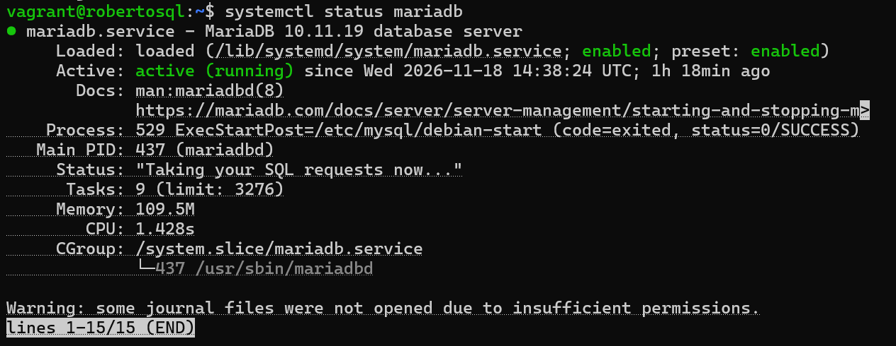

Si el resultado muestra active (running), significa que el servicio MariaDB está iniciado y funcionando.

Además, el script realiza una comprobación automática del estado de MariaDB y de nftables mediante:

```bash
systemctl is-active --quiet mariadb
systemctl is-active --quiet nftables
```

De esta forma, se comprueba que ambos servicios se encuentran activos al finalizar el aprovisionamiento.

---

## 07 / Incorporación de la aplicación

Una vez que los dos servidores estén preparados, instalaré la aplicación de gestión de usuarios indicada por el profesor.

Antes de copiar los archivos revisaré su estructura y los requisitos necesarios para que funcione.

### Revisión de los archivos originales

[\[URL DEL REPOSITORIO ORIGINAL\]](https://github.com/josejuansanchez/iaw-practica-lamp?utm_source)

La aplicación está desarrollada principalmente en PHP y utiliza HTML para generar los formularios y mostrar la información en el navegador.

  Apache2: servidor web encargado de recibir las peticiones.

  PHP: intérprete necesario para ejecutar el código de la aplicación.

  libapache2-mod-php: módulo que permite ejecutar PHP desde Apache.

  php-mysql: extensión que permite conectar PHP con MySQL o MariaDB.

  MariaDB: sistema gestor de bases de datos donde se almacenará la información.

El proyecto está dividido en dos directorios principales:

  src/: contiene los archivos de la aplicación web.

  db/: contiene el archivo SQL con la estructura inicial de la base de datos.

Dentro de src/ destacan los siguientes archivos:

  index.php: página principal desde la que se muestran los registros almacenados.

  add.html: formulario para introducir nuevos registros.

  add.php: procesa los datos del formulario y los inserta en la base de datos.

  edit.php: permite modificar los registros existentes.

  delete.php: realiza el borrado de registros.

  config.php: contiene los datos necesarios para establecer la conexión con MariaDB.

La aplicación utiliza operaciones CRUD (Create, Read, Update y Delete), es decir, permite crear, consultar, modificar y eliminar registros.

### Base de datos de la aplicación

Primero prepararé las tablas necesarias para almacenar la información.

Si el proyecto incluye un archivo SQL, revisaré su contenido antes de utilizarlo.

**Archivo SQL utilizado:**

```text
aplicacion/db/database.sql
```

**Nombre de la base de datos:**

```text
lamp_db
```

**Consultas de comprobación:**

```sql
SHOW DATABASES;
```

```sql
USE lamp_db;
SHOW TABLES; 
```

```sql
SELECT User, Host FROM mysql.user;
```

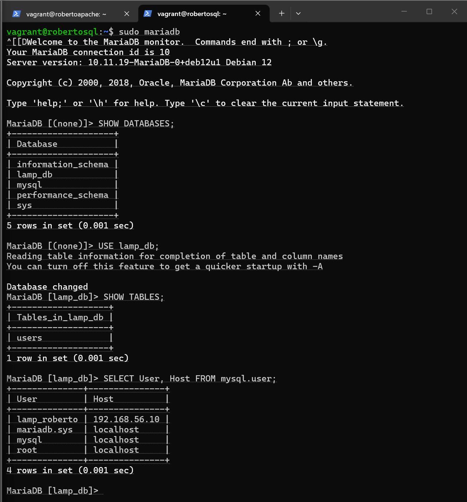

La base de datos lamp_db contiene las tablas necesarias para que funcione la aplicación de gestión de usuarios.

Estas tablas permiten almacenar y consultar los registros que utiliza la aplicación. Su estructura se ha obtenido a partir del archivo database.sql proporcionado en el repositorio original.

### Configuración de la conexión

La aplicación se ejecutará en `rmg-site`, pero deberá utilizar la base de datos instalada en `rmg-data`.

Por eso, en el archivo de configuración de la aplicación utilizaré la dirección privada del segundo servidor.

```text
Servidor: 192.168.56.20
Puerto:   3306
Base:     lamp_db
Usuario:  lamp_roberto
```

No utilizaré `localhost` para la conexión con la base de datos desde Apache, ya que los dos servicios están en equipos distintos.

**Archivo que contiene la configuración:**

```text
aplicacion/src/config.php
```

En el archivo config.php modificaré las constantes de conexión para utilizar los datos de mi infraestructura:

  DB_HOST: dirección privada del servidor MariaDB (192.168.56.20).
  DB_NAME: nombre de la base de datos (lamp_db).
  DB_USER: usuario de MariaDB (lamp_roberto).
  DB_PASSWORD: contraseña configurada para dicho usuario.

De esta forma, cuando PHP necesite consultar o modificar información, se conectará al servidor de datos mediante la red privada.

La contraseña real de la base de datos no se publicará en GitHub.

### Archivos del servidor web

En Debian, la ubicación habitual de los archivos publicados por Apache es:

```text
/var/www/html/
```
Utilizaré ese directorio o el que corresponda según la configuración de la aplicación.

**Comandos empleados para instalarla:**

Los paquetes necesarios para ejecutar la aplicación se instalan desde el script bootstrap/web-setup.sh:

```bash
apt-get update
apt-get install -y apache2 php libapache2-mod-php php-mysql
systemctl enable --now apache2
```
Los archivos PHP se encuentran en aplicacion/src/ y se comparten automáticamente con /var/www/html/ mediante la configuración synced_folder del archivo Vagrantfile.

Los archivos PHP se encuentran en aplicacion/src/ y se comparten automáticamente con /var/www/html/ mediante la configuración synced_folder del archivo Vagrantfile.

Por tanto, no es necesario realizar una copia manual de los archivos cada vez que se inicia la máquina.

El directorio compartido está configurado para utilizar el usuario y grupo www-data, correspondientes al servidor Apache.

Además, se instalará la extensión php-mysql, necesaria para que PHP pueda comunicarse con MariaDB.

Con esta configuración, el servidor web podrá ejecutar la aplicación y acceder a la información almacenada en el segundo servidor.

---

## 08 / Acceso desde el ordenador principal

Una vez instalados y configurados los servicios, comprobaré que la aplicación web pueda abrirse desde el ordenador principal con Windows.

La conexión se realizará mediante el reenvío de puertos configurado en el Vagrantfile.

```text
WINDOWS                  APACHE
127.0.0.1:8080    ->     192.168.56.10:80
```

De esta forma, las peticiones que lleguen al puerto 8080 del ordenador anfitrión se redirigirán al puerto 80 del servidor Apache.

Para acceder a la aplicación utilizaré el navegador de Windows y escribiré la siguiente dirección:

```text
http://127.0.0.1:8080
```

No será necesario acceder directamente a la máquina virtual ni utilizar la dirección IP de MariaDB. El navegador se comunicará con Apache, que será el encargado de procesar la aplicación y conectarse al servidor de datos cuando sea necesario.

**Dirección final de la aplicación:**

[\[URL de la página\]](http://127.0.0.1:8080)

Si la aplicación se encuentra dentro de un subdirectorio, añadiré su nombre al final de la dirección.

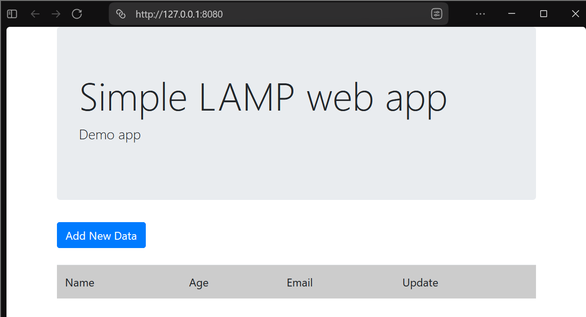

Al acceder a la dirección desde Windows, comprobaré que el navegador puede comunicarse con el servidor Apache y mostrar la aplicación web.

Si la página principal se carga correctamente, quedará comprobado que el reenvío de puertos funciona y que el servidor web es accesible desde el ordenador anfitrión.

Además, si la aplicación consigue mostrar la información almacenada en MariaDB, también quedará comprobada la comunicación entre el servidor web y el servidor de datos.

---

## 09 / Registro de pruebas de la aplicación

En esta parte comprobaré que la aplicación no solo muestra su página principal, sino que también puede trabajar con los datos almacenados en MariaDB.

Realizaré las operaciones que tenga disponibles.

### Prueba A — Consultar información

Accederé a la página principal de la aplicación desde el navegador. En ella se mostrará el listado de registros almacenados en la base de datos.

La aplicación realizará una consulta a MariaDB para recuperar la información y mostrarla en pantalla.

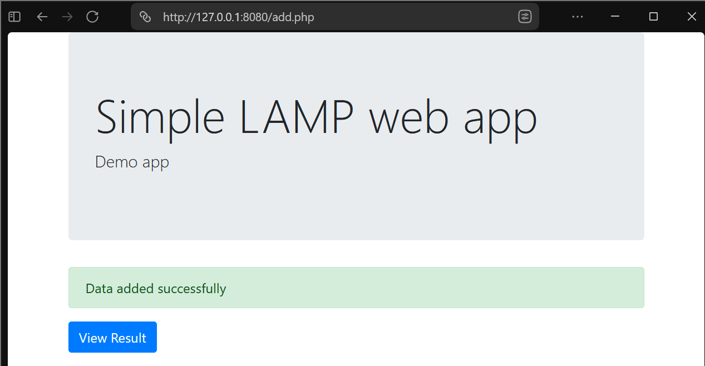

En la captura se Puede comprobar si la aplicación muestra correctamente los registros almacenados en la base de datos. Si aparecen los datos, quedará verificado que PHP puede consultar la información de MariaDB y mostrarla en el navegador.

### Prueba B — Añadir un registro

Accederé al formulario de creación de registros y completaré sus campos con datos de prueba.

A continuación, enviaré el formulario para que el archivo add.php procese la información y la almacene en MariaDB.

Después volveré al listado principal para comprobar que el nuevo registro aparece correctamente.

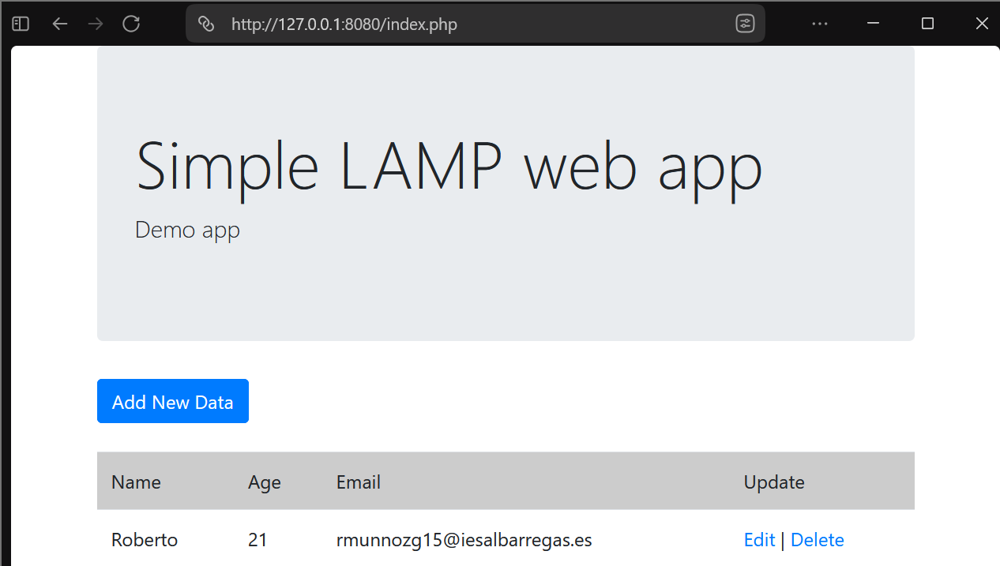

El registro se ha añadido correctamente y si aparece en el listado.

### Prueba C — Cambiar información

Seleccionaré uno de los registros existentes y accederé a su formulario de edición.

Modificaré alguno de sus datos y guardaré los cambios. El archivo edit.php se encargará de procesar la actualización en la base de datos.

Finalmente, volveré al listado para comprobar que aparece la información modificada.

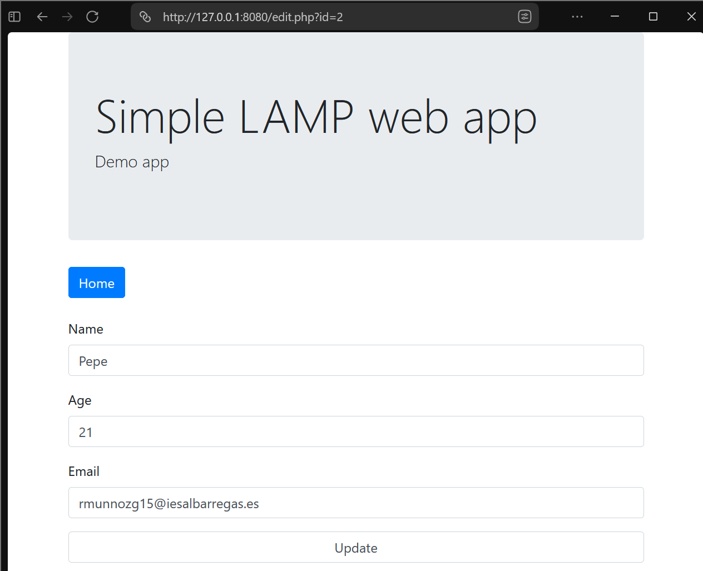

Los cambios se han guardado y se muestra la información actualizada.

### Prueba D — Borrar un registro

Seleccionaré un registro de prueba y utilizaré la opción de eliminación de la aplicación.

La petición será procesada por el archivo delete.php, que se encargará de eliminar el registro de la base de datos.

Después volveré al listado para comprobar que el registro ya no aparece.

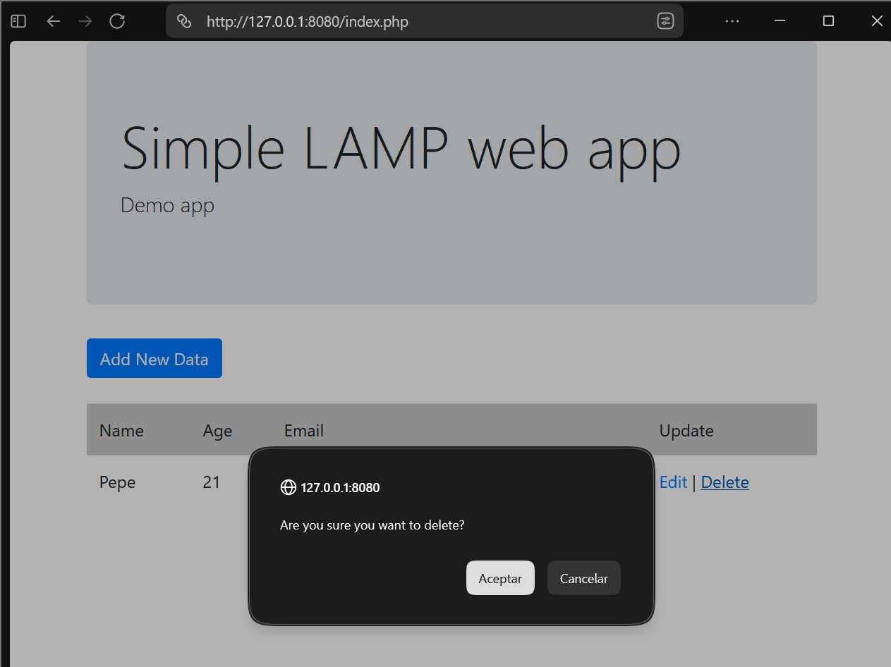

El registro se ha eliminado correctamente y ha desaparecido del listado.

Las pruebas se ajustarán a las funciones reales que tenga la aplicación.

---

## 10 / Demostración del resultado

Además de las capturas, prepararé una grabación donde se pueda ver la aplicación funcionando.

En el vídeo mostraré el acceso desde Windows y las operaciones de gestión de usuarios que haya comprobado.

También enseñaré brevemente que la aplicación y la base de datos funcionan en máquinas diferentes.

```text
grabacion/recorrido.mp4
```

[\[URL del vídeo\]](https://youtu.be/W4Z7k-gSgQ8)

---

## Recursos utilizados

Durante el desarrollo consultaré los materiales del profesor y la documentación de las herramientas utilizadas.

Para comprender y realizar la configuración de los servidores he utilizado los siguientes documentos:

Vagrant.pdf: material relacionado con la utilización y configuración de Vagrant.

LAMP Stack en Ubuntu Server.pdf: apuntes sobre la instalación y configuración de los componentes de una arquitectura LAMP.

LAMPDosNiveles.pdf: documentación sobre la separación del servidor web y el servidor de base de datos en dos máquinas diferentes.

---

## Datos del trabajo

**Realizado por:** Roberto Muñoz Galán 
**Ciclo formativo:** ASIR 2
**Módulo:** Implantación de Aplicaciones Web

**Fecha de realización:** 18/11/2026
