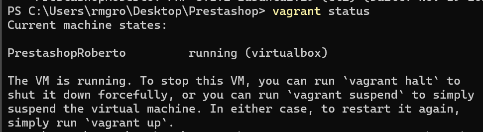
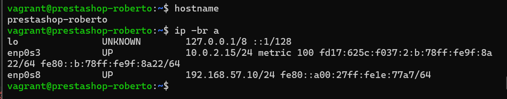
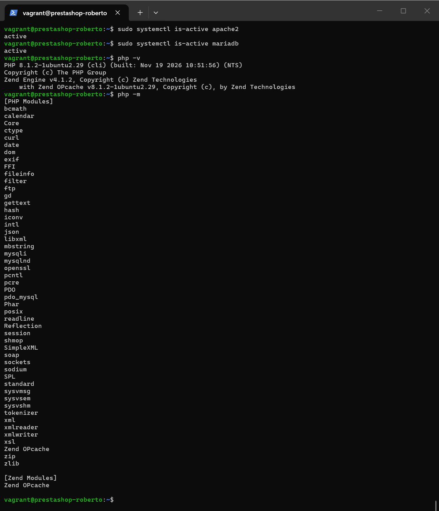
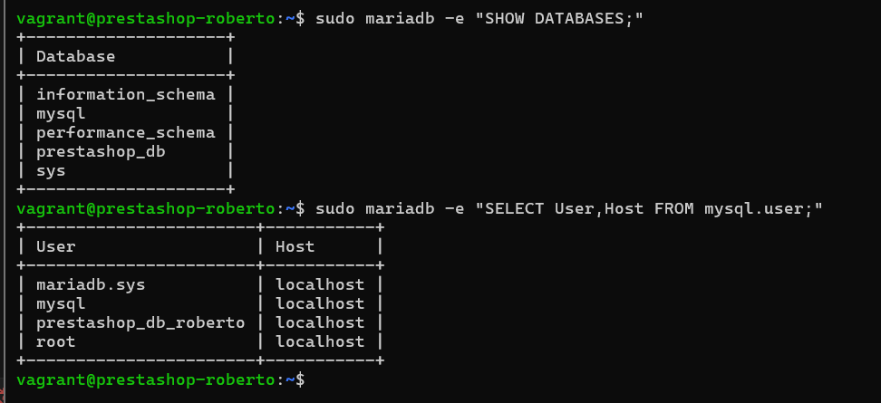
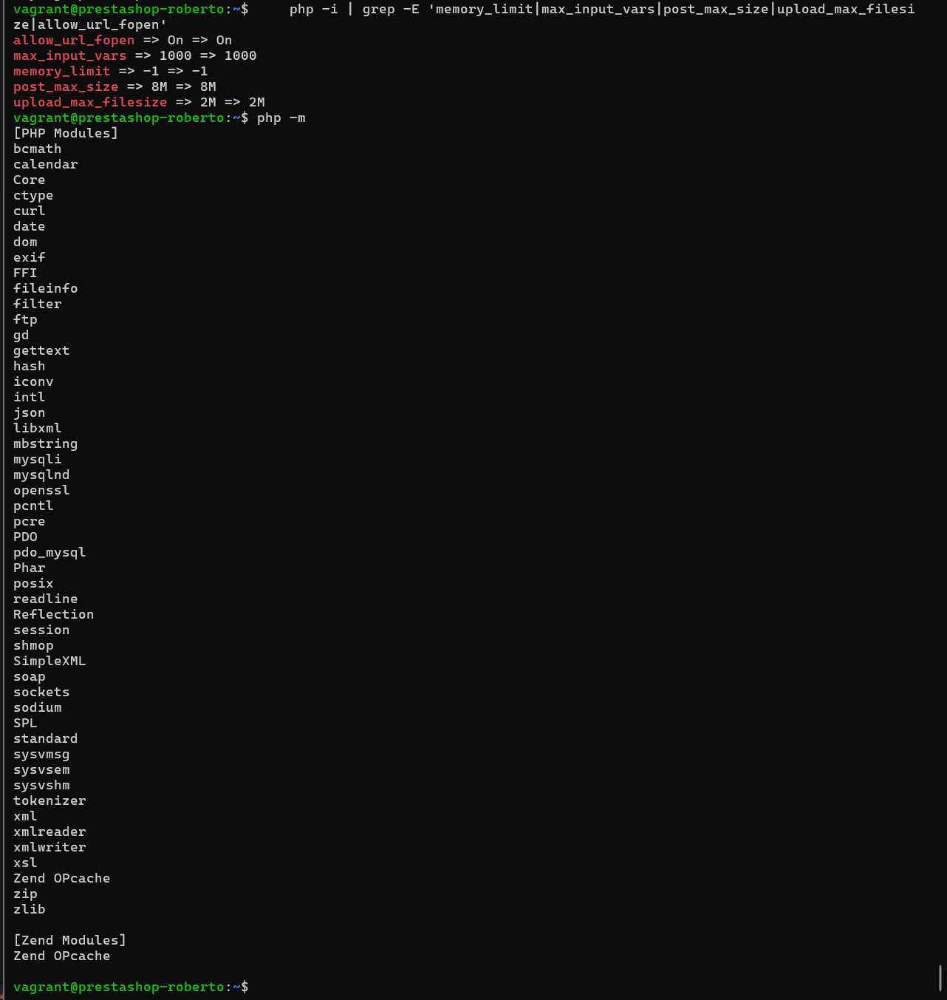
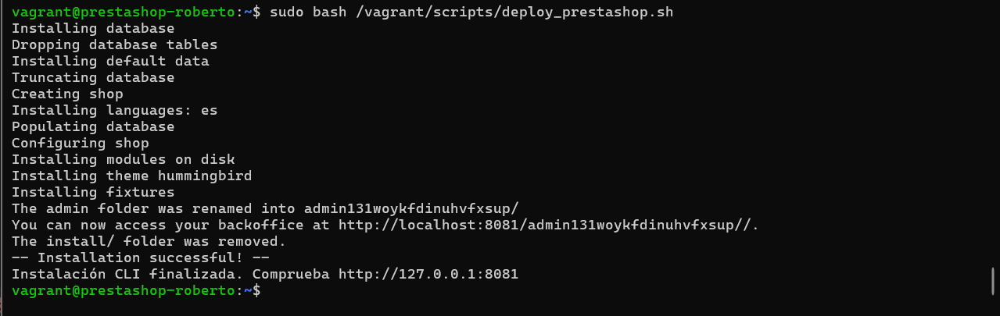
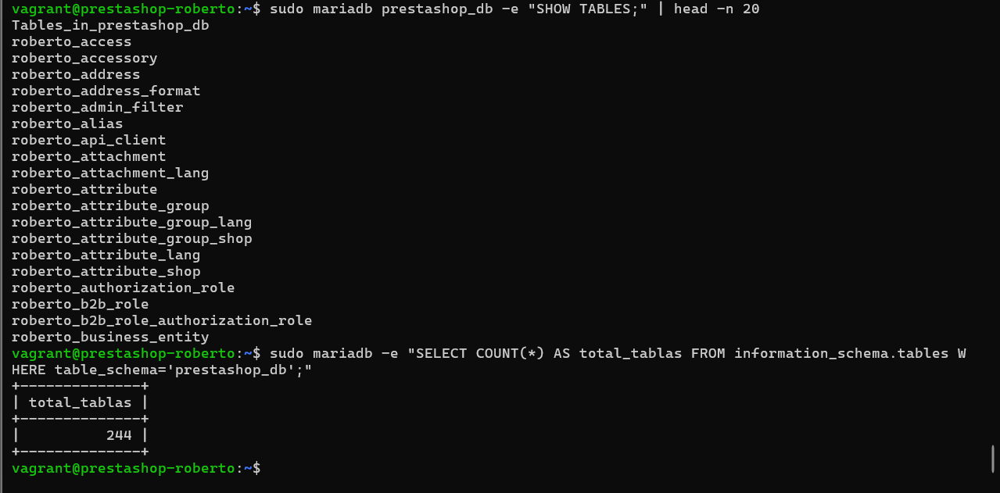
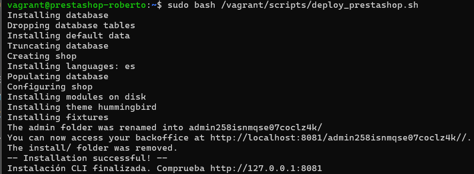
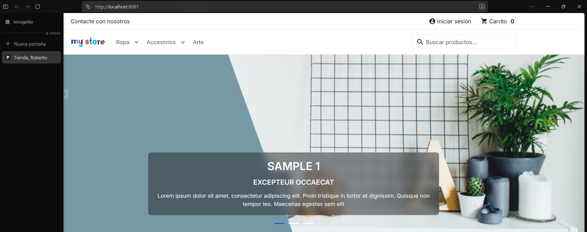

# Tienda online PrestaShop con Vagrant

### Despliegue local de una pila LAMP en Ubuntu 22.04

**Documento técnico — Roberto Muñoz Galán**

---

## Índice

- [Vista general del laboratorio](#vista-general-del-laboratorio)
- [01 / Preparación del escenario](#01--preparación-del-escenario)
- [02 / Archivos del laboratorio](#02--archivos-del-laboratorio)
- [03 / Construcción de la máquina](#03--construcción-de-la-máquina)
- [04 / Instalación de la pila LAMP](#04--instalación-de-la-pila-lamp)
- [05 / Comprobación de requisitos](#05--comprobación-de-requisitos)
- [06 / Instalación de PrestaShop desde CLI](#06--instalación-de-prestashop-desde-cli)
- [07 / Dominio y certificado HTTPS](#07--dominio-y-certificado-https)
- [08 / Pruebas de la tienda](#08--pruebas-de-la-tienda)
- [09 / Evidencias y vídeo](#09--evidencias-y-vídeo)
- [Incidencias y limitaciones](#incidencias-y-limitaciones)
- [Recursos utilizados](#recursos-utilizados)
- [Datos del trabajo](#datos-del-trabajo)

---

## Vista general del laboratorio

El objetivo es instalar y documentar PrestaShop sobre una pila LAMP. La guía docente propone una instancia EC2 con Ubuntu, al menos 2 GB de RAM, acceso SSH/HTTP/HTTPS, IP elástica, dominio, Certbot y scripts Bash. Como no se dispone de AWS, se adapta el escenario a una máquina virtual local creada con Vagrant y VirtualBox.

La máquina de Vagrant se define como PrestashopRoberto y utiliza Ubuntu Server 22.04 LTS sin entorno gráfico. Ejecutará Apache, PHP y MariaDB, como una instancia LAMP. Desde Windows se accederá por http://127.0.0.1:8081. La instalación se realizará desde la interfaz CLI.

| Componente | Configuración |
|---|---|
| VM | PrestashopRoberto / hostname prestashop-roberto |
| Sistema | Ubuntu 22.04 (ubuntu/jammy64) |
| Recursos | 2 CPU y 2048 MB RAM |
| IP privada | 192.168.57.10 |
| HTTP / HTTPS local | 127.0.0.1:8081 / 127.0.0.1:8444 |
| Servicios | Apache, PHP y MariaDB |

> Estado inicial: archivos y guía preparados. La VM, la tienda, el dominio y las pruebas aún deben ejecutarse. No marques una fase como completada sin verificarla.

---

## 01 / Preparación del escenario

Instala VirtualBox y Vagrant en Windows. Comprueba desde PowerShell:

    vagrant --version
    VBoxManage.exe --version

Crea el archivo privado de variables:

    cd C:\Users\rmgro\Desktop\Prestashop
    Copy-Item .\scripts\.env.example .\scripts\.env
    notepad .\scripts\.env

Cambia las contraseñas de MariaDB y del administrador y escribe tu correo. Utiliza una contraseña SQL alfanumérica aleatoria. El archivo scripts/.env está excluido de Git: no publiques secretos ni los muestres en capturas.

---

## 02 / Archivos del laboratorio

    Prestashop/
    ├── README.md
    ├── .gitignore
    ├── Vagrantfile
    ├── dist/
	│    └── prestashop_edition_basic_version_9.2.1-6.1.zip
    ├── scripts/
    │   ├── .env
    │   ├── install_lamp.sh
    │   ├── setup_letsencrypt_https.sh
    │   └── deploy_prestashop.sh
    ├── conf/
    ├── pruebas/
	    ├── 01-inicio/
		├── 02-maquina/
	    ├── 03-requisitos/
	    ├── 04-instalacion/
	    ├── 05-tienda/
	    └──06-https/

---

## 03 / Construcción de la máquina

La caja `ubuntu/noble64` del primer borrador devolvió HTTP 404 en el catálogo de Vagrant. Se sustituyó por `ubuntu/jammy64`, caja Ubuntu 22.04 disponible en el registro.

El Vagrantfile define la VM con el identificador PrestashopRoberto y hostname prestashop-roberto. Utiliza Ubuntu Server 22.04, 2 CPU, 2048 MB de RAM, IP privada 192.168.57.10 y reenvía el puerto 80 al 8081 de Windows.

En PowerShell:

    cd C:\Users\rmgro\Desktop\Prestashop
    vagrant validate
    vagrant up
    vagrant status

El primer arranque ejecuta scripts/install_lamp.sh automáticamente y puede tardar varios minutos. Identifica la VM:

    vagrant ssh PrestashopRoberto
Dentro de Linux:

    hostname
    ip -br a
    ip route

La interfaz privada debe mostrar 192.168.57.10.

**Estado de Vagrant**

**Identidad y red**

Comandos útiles:

    vagrant provision
    vagrant halt

vagrant destroy elimina el disco virtual y los datos de la tienda.

---

## 04 / Instalación de la pila LAMP

El aprovisionador instala Apache, PHP, extensiones comunes para PrestaShop y MariaDB. También activa rewrite y establece memory_limit en 512 MB.

Comprueba los servicios:

    sudo systemctl is-active apache2
    sudo systemctl is-active mariadb
    php -v
    php -m

Desde Windows abre http://127.0.0.1:8081. Antes de instalar PrestaShop debe aparecer la página predeterminada de Apache.

La base prestashop_db y el usuario prestashop_user se crean usando scripts/.env.

    sudo mariadb -e "SHOW DATABASES;"
    sudo mariadb -e "SELECT User,Host FROM mysql.user;"

**Apache, PHP y MariaDB activos**

**BBDD de MariaDB activo**

---

## 05 / Comprobación de requisitos

La guía pide utilizar PhpPsInfo antes de instalar. Descarga phppsinfo.php desde el repositorio enlazado por la documentación oficial y colócalo temporalmente en /var/www/html.

Comprueba PHP:

´´´bash
	php -i | grep -E 'memory_limit|max_input_vars|post_max_size|upload_max_filesize|allow_url_fopen'
	php -m
´´´
Abre http://127.0.0.1:8081/phppsinfo.php. La herramienta muestra versiones, extensiones y permisos. Si solicita autenticación, consulta sus credenciales predeterminadas en el propio archivo. Al terminar, elimina el fichero:

    sudo rm -f /var/www/html/phppsinfo.php

La documentación vigente de PrestaShop 9 especifica Apache 2.4+, MariaDB 10.2+ y PHP compatible; admite PHP 8.1–8.5, y recomienda PHP 8.5 para las ramas 9.1–9.2. Esta VM utiliza PHP 8.1. Comprueba la matriz correspondiente a la versión descargada.

**Resultado de PhpPsInfo**

---

## 06 / Instalación de PrestaShop desde CLI

### Descarga el paquete

Descarga el paquete estable desde la [página oficial de versiones de PrestaShop](https://prestashop.com/versions/). Para PrestaShop 9, no descargues el ZIP de código fuente desde GitHub: la distribución de instalación se ofrece desde el sitio oficial. Anota la versión. El ZIP Basic descargado puede contener un segundo archivo interno llamado prestashop.zip; el script lo detecta y lo extrae automáticamente. Si hay un único ZIP en dist, también lo detecta aunque conserve el nombre largo de descarga. Guarda el archivo exterior en:

    C:\Users\rmgro\Desktop\Prestashop\dist\prestashop.zip

### Ejecuta el instalador

Edita scripts/.env y revisa DB_NAME, DB_USER, DB_PASSWORD, SHOP_NAME, SHOP_DOMAIN, ADMIN_EMAIL y ADMIN_PASSWORD. La contraseña de administrador debe ser alfanumérica, tener al menos 8 caracteres y ser fuerte; usa al menos 12 caracteres con mayúsculas, minúsculas y números. El script lo comprueba antes de copiar la tienda.

Desde PowerShell:

    vagrant ssh PrestashopRoberto
Dentro de la VM:

    sudo bash /vagrant/scripts/deploy_prestashop.sh

El script selecciona el ZIP exterior, extrae el ZIP interno prestashop.zip cuando existe, localiza install/index_cli.php aunque esté dentro de una carpeta y ejecuta el instalador con los datos de MariaDB y la cuenta administradora. La base debe existir previamente.

Al terminar, abre http://127.0.0.1:8081. Revisa servicios y tablas:

Si SHOW TABLES no devuelve filas, la base se ha creado pero el instalador de PrestaShop no ha terminado. Comprueba en Windows que dist/prestashop.zip existe; en la VM revisa si /var/www/html/install/index_cli.php está presente. Si la carpeta web aún contiene únicamente index.html, coloca el paquete oficial en dist/prestashop.zip y vuelve a ejecutar el script. Si el instalador da un error, conserva su salida completa para localizar si es un fallo de extracción, de PHP o de conexión con MariaDB.

    sudo systemctl status apache2 --no-pager
    sudo systemctl status mariadb --no-pager
    sudo mariadb prestashop_db -e "SHOW TABLES;"

Accede al Back Office con la ruta que haya generado PrestaShop. No publiques la contraseña.

**Instalación CLI completada**

**Tablas de PrestaShop**

---

## 07 / Dominio y certificado HTTPS

La IP privada de Vagrant y el reenvío a 127.0.0.1 solo sirven para acceso local; no equivalen a una IP elástica ni permiten validar HTTP-01 desde Internet. Para emitir un certificado de Let's Encrypt, el dominio debe resolver a la IP pública del router y el router debe reenviar TCP 80 a esta VM. El sitio también debe ser accesible desde una red externa durante la validación.

Si reutilizas rmunnozg15.ddns.net del laboratorio de balanceo, cambia temporalmente el reenvío TCP 80/443 del router para que llegue a la IP LAN de esta VM. No apuntes el mismo dominio a ambas máquinas. Reserva la IP LAN para evitar cambios. Completa LETSENCRYPT_DOMAIN y LETSENCRYPT_EMAIL en scripts/.env y ejecuta:

    sudo bash /vagrant/scripts/setup_letsencrypt_https.sh
    sudo certbot certificates
    sudo certbot renew --dry-run

El script pide confirmar que se ha comprobado el acceso HTTP público. No lo ejecutes antes de que el dominio y el puerto 80 lleguen a esta máquina.

**Certificado y renovación simulada**

---

## 08 / Pruebas de la tienda

Desde el navegador:

1. Carga la página inicial.
2. Abre una categoría y un producto.
3. Añade el producto al carrito.
4. Entra en el Back Office y enseña el catálogo.
5. Comprueba que MariaDB contiene las tablas.
6. Si Certbot se ha configurado, abre el dominio por HTTPS.

**Tienda Prestashop desde el navegador**

---

## Incidencias y limitaciones

- No hay acceso a AWS; EC2 se sustituye por Vagrant y VirtualBox. No se dispone de IP elástica ni de grupos de seguridad AWS.
- Certbot requiere que DNS y router apunten a la VM, por lo que el reenvío local de Vagrant no basta.
- Para usar el dominio del balanceador, hay que cambiar temporalmente los puertos reenviados en el router.

---

## Recursos utilizados

- Guía docente PrestashopAWS.pdf.
- [Requisitos oficiales de PrestaShop 9](https://devdocs.prestashop-project.org/9/basics/installation/system-requirements/).
- [Instalación oficial desde CLI](https://devdocs.prestashop-project.org/9/basics/installation/advanced/install-from-cli/).
- [Versiones y descargas oficiales de PrestaShop](https://prestashop.com/versions/).
- [Documentación de Vagrant](https://developer.hashicorp.com/vagrant/docs).
- [Documentación de Certbot](https://certbot.eff.org/).

---

## Datos del trabajo

**Realizado por:** Roberto Muñoz Galán  
**Ciclo formativo:** ASIR 2  
**Módulo:** Implantación de Aplicaciones Web  
**Fecha de inicio:** 20/11/2026  
