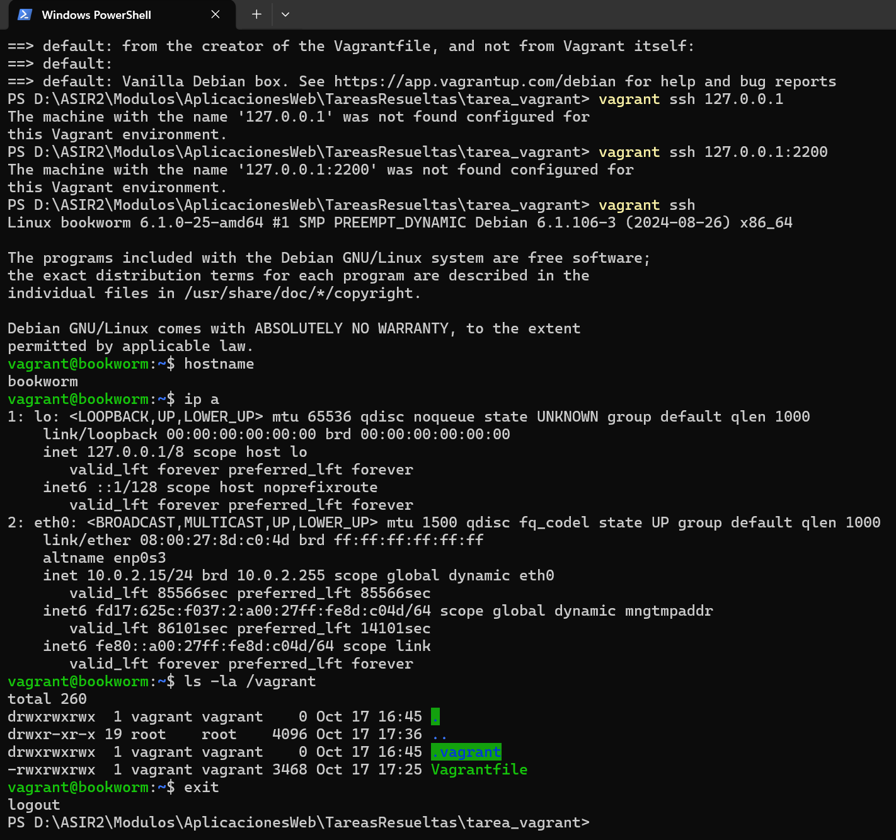

# Práctica de Investigación: Primeros Pasos con Vagrant

---

## Datos de la práctica

- **Nombre y Apellidos:** Roberto Muñoz Galán
- **Grupo:** ASIR 2
- **Asignatura:** Administración de aplicaciones web 
- **Fecha:** 14/10/2026

---

## Índice


---

## 1. Introducción y Justificación
Vagrant es una herramienta que automatiza la creación y gestión de entornos de desarrollo virtualizados. Permite definir la infraestructura mediante código (`Vagrantfile`), garantizando que todos los miembros del equipo trabajen bajo un entorno exactamente identico.

---

### Parte A. Investiga antes de modificar el entorno
1. **Vagrant y el Vagrantfile.** Explica brevemente qué problema resuelve Vagrant y distingue el anfitrión, el proveedor de virtualización, la box y la máquina virtual. Averigua en qué lenguaje está escrito el `Vagrantfile`. Analiza el archivo inicial y, al terminar la práctica, comenta **cada línea activa del archivo final**: qué configura, por qué la añadiste y cómo compruebas que ha surtido efecto.

- Vagrant resuelve el problema de "en mi máquina funciona" automatizando la creación, configuración y aprovisionamiento de entornos de desarrollo reproducibles y portables mediante archivos de configuración compatibles en control de versiones.
- Conceptos clave:
	- El anfitrión es tu equipo fñisico donde ejecutas el software de virtualización y Vagrant.
	- El proovedor de virtualización es el hipervisor que utilizas encargado de crear y gestionar la máquina virtual.
	- Box es la imagen base preconfigurada desde la cual se descarga e inicializa la máquina virtual.
	- La máquina virtual es el sistema operativo que se ejecutra dentro del hipervisor.
- El Vagrantfile está escrito en el lenguaje llamado Ruby.

---

2. **Aprovisionamiento.** Investiga qué es un **provisioner**, dónde se ejecuta el script, cuándo lo lanza Vagrant y qué diferencia hay entre `inline:` y `path:`. Explica qué ocurre si modificas el script después del primer `vagrant up` y cómo lo ejecutarías de nuevo.

- **¿Qué es?:** Es una herramienta utilizada por Vagrant para ejecutar comandos o scripts automáticamente al crear la VM.
- **Ubicación de ejecución:** Se ejecuta dentro de la máquina virtual.
- **¿Cuándo se lanza?:** Automáticamente la primera vez al ejecutar vagrant up. En arranques posteriores, no se vuelve a ejecutar salvo que se especifique explicitamente la bandera --provision o el comando dedicado vagrant provision.
- **Diferencia entre inline: y path: :**
	- **inline:** Permite escribir directamente una línea o conjunto de comandos shell integrados en el código Ruby del Vagrantfile.
	- **path:** Apunta a un archivo de script externo (ej. script.sh) presente en la máquina anfitriona.   
- **Si modificas el script tras el primer vagrant up:** La modificación no se aplicará automáticamente. Para volver a ejecutar únicamente el script se debe usar:

```
vagrant provision
```

---

3. **Interfaces y redes** Investiga qué conexión de red configura Vagrant por defecto y para qué la utiliza. Averigua cómo se añade en el Vagrantfile una segunda interfaz con dirección IP fija. Compara NAT, red interna, red privada host-only y red pública: explica con quién puede comunicarse la máquina en cada caso y qué función cumple el reenvío de puertos. 
Presta especial atención a la diferencia entre la red interna de VirtualBox y la red privada host-only de VMware. Investiga cómo se configura la segunda interfaz en el proveedor que utilices. ¿Añadirla elimina la NAT predeterminada? ¿El reenvío de puertos crea una interfaz nueva?
En la parte C configurarás una máquina con dos interfaces: NAT y red de laboratorio. Examina después sus direcciones y rutas de red, relaciona lo observado con el Vagrantfile e incluye un esquema de la arquitectura en tu README.md. Como solo hay una máquina, no se pide demostrar comunicación con otra VM.

- Vagrant configura siempre como primera interfaz una red tipo NAT. La utiliza para proporcionar acceso directo a Internet a la VM y para permitir la comunicación administrativa SSH entre el anfitrión y la VM mediante reenvío automático de puertos.
- **Cómo añadir una segunda interfaz privada:**
```
config.vm.network "private_network", ip: "192.168.56.10"
```

- **Comparativa de modalidades de red:**
	- **NAT:** Salida del guest a Internet a través de la IP del anfitrión. Inaccesible desde el exterior hacia la VM sin reenvío de puertos.
	- **Red Interna:** Permite la comunicación única y exclusivamente entre máquinas virtuales que compartan el mismo nombre de red interna. Sin acceso al anfitrión ni a Internet.
	- **Red Privada:** Permite comunicación directa bidireccional entre el anfitrión y las máquinas virtuales dentro de esa red. No es accesible desde la red física local externa.
	- **Red Pública:** La VM se comporta como un dispositivo físico más conectado directamente a la red local física, recibiendo IP del router local.

*Añadir una segunda interfaz no elimina la interfaz NAT predeterminada , la NAT predeterminada siempre se mantiene en la primera interfaz (eth0/enp0s3) para garantizar la gestión y la salida a Internet.*
*El reenvio de puertos no crea una interfaz nueva, aprovecha la interfaz NAT existente para realizar una traducción de puertos.*
---

4. **Órdenes y carpeta compartida.** En una tabla breve, indica cuándo usarías `up`, `status`, `ssh`, `reload`, `provision`, `halt` y `destroy`; marca cuáles llegaste a ejecutar. Averigua qué es `/vagrant` y comprueba qué archivos aparecen allí.

| Comando Vagrant | Uso principal | ¿Se ejecuta? |
| vagrant up | Crea e inicia la máquina virtual, ejecutando el aprovisionamiento inicial. | Sí |
| vagrant status | Muestra el estado actual de la máquina. | Sí |
| vagrant ssh | Conecta por línea de comandos vía SSH al sistema guest sin pedir clave. | Sí |
| vagrant reload | Reinicia la máquina virtual y aplica los cambios realizados en el Vagrantfile. | Sí |
| vagrant provision | Ejecuta de nuevo únicamente los scripts de aprovisionamiento. | Sí |
| vagrant halt | Apaga la máquina virtual de forma controlada. | Sí |
| vagrant destroy | Elimina por completo la máquina virtual y sus discos asociados. | Sí |

- ¿Qué es /vagrant?: Es el punto de montaje dentro de la máquina virtual que sincroniza de forma compartida en tiempo real todo el contenido de la carpeta del proyecto en el equipo anfitrión.

---

### Parte B. Mi primera máquina en Vagrant
Trabaja desde el directorio del `Vagrantfile`. Comprueba que el archivo es válido y arranca la máquina con el proveedor que tengas instalado: VirtualBox (Recomendada) o VMware
Workstation Pro. **Entra por SSH. Comprueba el nombre de la máquina, la versión de Debian, las interfaces y las rutas de red.**

---

### Parte C. Completa el Vagrantfile
Modifica el archivo inicial para crear **una máquina Debian 12 con dos interfaces o adaptadores de red:**
- Asigna un **hostname** identificable con tu nombre.
- Conserva la **NAT que Vagrant configura por defecto** como primera interfaz. Identifica qué dirección y ruta recibe dentro de Debian.
- Añade una segunda interfaz con **IP fija en una red de laboratorio**. En VirtualBox configúrala como red interna; en VMware Workstation Pro utiliza una red privada de tipo host-only y explica en `README.md`
la diferencia entre ambas modalidades. Puedes usar `192.168.56.10` como referencia si no entra en conflicto con otra red del equipo.
- Reenvía el puerto **80 de la máquina virtual al 8080 del anfitrión**, únicamente por `127.0.0.1`. Si el 8080 está ocupado, elige otro y justifícalo.
- Vincular un script Bash de aprovisionamiento guardado en el repositorio.

---

### Parte D. Aprovisiona Apache
Crea un script Bash que instale Apache en Debian 12, active el servicio y escriba una página de inicio
sencilla. Esa página debe mostrar tu nombre y el hostname de la máquina. Investiga cómo volver a
ejecutar solo el aprovisionamiento después de modificarlo. Ejecútalo de nuevo y comprueba que el
servidor continúa funcionando.

---

## 2. Esquema de Arquitectura de Red
```
Anfitrión (browser en localhost:8080) ---> [NAT / Puerto 8080] ---> VM Debian (Apache en puerto 80 / IP 192.168.56.10)
```

## 3. Configuración del Vagrantfile
Contenido detallado del archivo `Vagrantfile` utilizado en el proyecto:

```ruby
Vagrant.configure("2") do |config|
  config.vm.box = "debian/12"
  config.vm.hostname = "servidor-debian-juan"
  config.vm.network "private_network", ip: "192.168.56.10"
  config.vm.network "forwarded_port", guest: 80, host: 8080, host_ip: "127.0.0.1"
  config.vm.provision "shell", path: "script.sh"
end
```

## 4. Script de Aprovisionamiento (`script.sh`)
```bash
#!/bin/bash
export DEBIAN_FRONTEND=noninteractive
apt-get update -y
apt-get install -y apache2

systemctl start apache2
systemctl enable apache2

cat <<EOF> /var/www/html/index.html
<!DOCTYPE html>
<html>
<head><title>Vagrant Apache</title></head>
<body>
    <h1>Servidor Web Desplegado</h1>
    <p>Nombre: Juan Pérez</p>
    <p>Hostname: $(hostname)</p>
</body>
</html>
EOF
```

### Explicación de las órdenes del script:
* `export DEBIAN_FRONTEND=noninteractive`: Evita que `apt` solicite confirmaciones interactivas durante la instalación.
* `apt-get update -y`: Actualiza el repositorio de paquetes de Debian.
* `apt-get install -y apache2`: Instala el paquete del servidor web Apache.
* `systemctl start/enable apache2`: Inicia el servicio inmediatamente y lo configura para iniciarse en cada arranque.
* `cat <<EOF > ...`: Genera el archivo HTML estático incluyendo el nombre y el comando `$(hostname)` que recupera el nombre de la máquina.

## 5. Pruebas de Funcionamiento y Verificación

1. **Verificación dentro de la VM (`vagrant ssh`):**
   * Verificación del nombre de host: `hostname`
   * Inspección de IPs: `ip a`
   * Comprobación de rutas de red: `ip route`
   
2. **Acceso desde el Host Anfitrión:**
   * Abriendo un navegador en el anfitrión e ingresando a `http://127.0.0.1:8080` o `http://192.168.56.10`.
   

*(Aquí se deben insertar las capturas de pantalla de la terminal y del navegador cargando la página web).*
